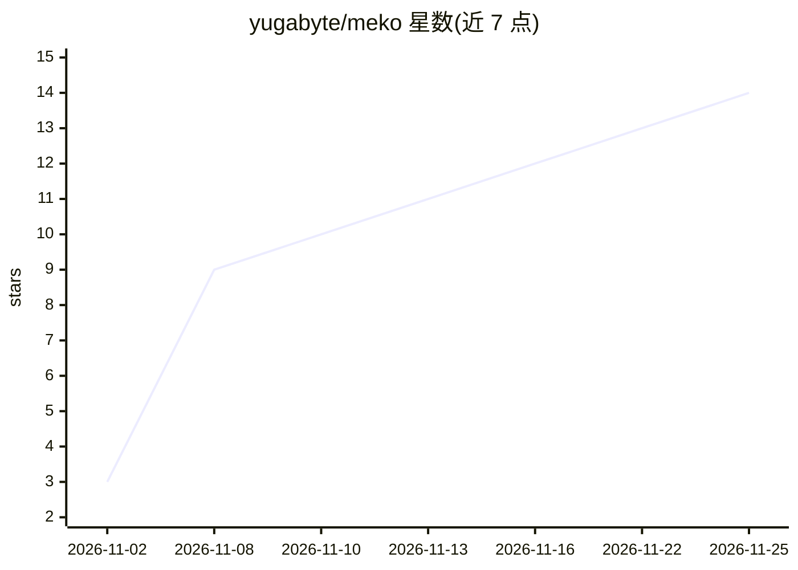

# yugabyte/meko

⭐ 14 · TypeScript · Apache-2.0 · 推送 2026-11-23 · [GitHub](https://github.com/yugabyte/meko) · [官网](https://mekodata.ai) · 组织维护

**面向 agent 应用的上下文引擎：统一记忆、知识与决策轨迹**

Meko 提供一个本地运行的单二进制上下文引擎，聚合 agent 的集体记忆、共享知识与决策轨迹，按 datapack 组织。二进制内含命令行、服务器、MCP 工具与 REST API；通过 `meko agent connect` 将上下文接入 Claude、Codex 等 MCP 客户端。底层采用混合检索（语义+关键词，cross-encoder 重排）、对话记忆抽取与文件嵌入，本地数据在本地嵌入。仅支持 Apple Silicon macOS 14+ 与 Linux x64/arm64，不支持 Windows；可选链接 Meko Cloud。

## 筛选速览

| 维度 | 判定 | 备注 |
|---|---|---|
| AI 角色 | `ai-ecosystem` | LLM/agent 周边工具 |
| 许可风险 | `permissive` | Apache-2.0 |
| 部署形态 | `None` |  |
| 模型依赖 | — | README 未给出锁定关系 |
| 硬件要求 | — | 无带数字的原话,不猜 |
| 安装摩擦 | `low` | 无编译、无系统依赖或容器化 |
| 成熟度 | — | 结构信号不足 |

## 能力要点

- 单二进制同时提供 CLI、服务器、MCP 工具与 REST API
- datapack 组织记忆、知识库、对话与决策轨迹
- 混合检索 + cross-encoder 重排，嵌入与重排在本地运行
- 扩展 Kode 可并行运行多个编码 agent 会话

## 适用场景

- 给 Claude Code、Codex 等 agent 接入共享记忆与知识库
- 管理多个项目各自的上下文工作区
- 让多个编码会话共享设计决策与经验

## 场景标签

`Agent 记忆` `知识库管理` · 领域:Agent 开发

## 证据(README 行号)

> L10: **The Context Engine for Agentic Applications**
> L14: a single binary that has the command line, the server, the MCP tools and the REST API.
> L50: Give agents like Claude, Codex, or any MCP client, Meko's context. `meko agent connect` adds Meko

## 星数曲线

2026-11-02 3 → 2026-11-25 14（+11）

---
*卡片 v1 · prompt 1.4 · 生成 2026-11-18 · 置信度 high · 依据 README sha `ed4a64217801` · [字段定义](../../DATASET.md)*
