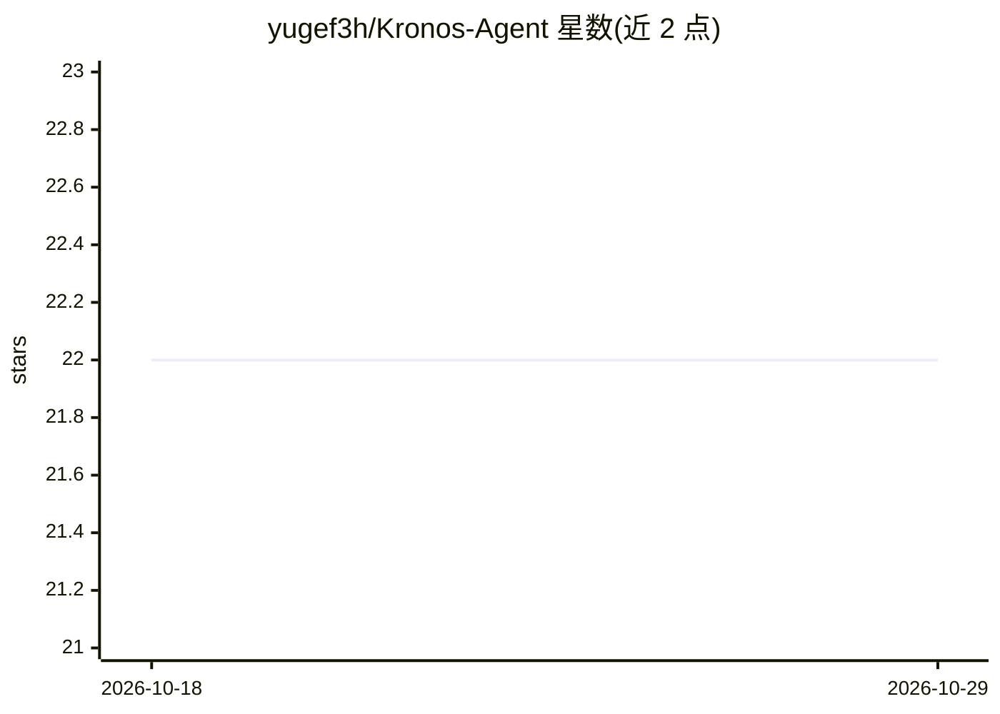

# yugef3h/Kronos-Agent

⭐ 22 · TypeScript · Apache-2.0 · 推送 2026-06-23 · [GitHub](https://github.com/yugef3h/Kronos-Agent) · 个人维护 · 中文 README

**面向开发者的全栈 AI Agent 工作台：对话、Workflow 编排与 RAG 评测**

开源的全栈 AI Agent 开发工作台（前端 + Node/Python 后端），提供 SSE 流式对话 Playground、可视化 Workflow 编排与单节点/整图调试、知识库与向量 RAG（自研引擎与 LangChain 实现可经 RAG_ENGINE_MODE 切换、同一 REST 契约）、RAG compare/evaluate 评测，以及多模型网关（豆包经 OpenAI 兼容接口）、异步队列（BullMQ/Redis）、三层缓存与限流。Context Engineering 做成可观测：滚动摘要、token 预算反选与记忆面板。部分能力为 localStorage 持久化的假发布/草稿，服务端持久化、MCP、多 Agent 列为缺口。

## 筛选速览

| 维度 | 判定 | 备注 |
|---|---|---|
| AI 角色 | `ai-ecosystem` | LLM/agent 周边工具 |
| 许可风险 | `permissive` | Apache-2.0 |
| 部署形态 | `library` | 以包/库形式分发 |
| 模型依赖 | — | README 未给出锁定关系 |
| 硬件要求 | — | 无带数字的原话,不猜 |
| 安装摩擦 | `low` | 无编译、无系统依赖或容器化 |
| 成熟度 | — | 结构信号不足 |

## 能力要点

- 可视化 Workflow 编排：整图 draft-run（SSE）与单节点调试 API
- RAG 知识库：混合检索、多问句改写、切片预估预览与 compare/evaluate 评测
- createMemoryPlan 滚动摘要 + token 预算反选，记忆面板展示模型实际上下文
- 多模型网关、BullMQ/Redis 异步长任务、三层缓存与 Token/并发限流

## 适用场景

- 搭建并调试带知识检索节点的 Agent 工作流
- 对比评测不同 RAG 配置的检索与回答效果
- 观测每轮对话实际拼装的上下文与 token 消耗

## 场景标签

`Agent 框架` `RAG` `工作流自动化` · 领域:Agent 开发

## 证据(README 行号)

> L3: **全栈 AI Agent 开源工作台**：流式对话、Workflow 编排、RAG 评测与多模型网关，把 Context Engineering 与工具调用做成可观测、可调试的 playground。
> L8: |Agent 系统|LangGraph + Function Calling、Context 记忆|**MCP**、**多 Agent 协作**、Harness|

## 星数曲线

2026-10-18 22 → 2026-10-29 22（+0）

---
*卡片 v1 · prompt 1.4 · 生成 2026-10-27 · 置信度 high · 依据 README sha `69d1e6f5a0e8` · [字段定义](../../DATASET.md)*
