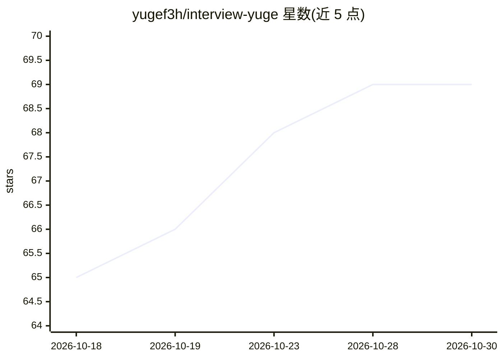

# yugef3h/interview-yuge

⭐ 69 · JavaScript · 推送 2026-07-09 · [GitHub](https://github.com/yugef3h/interview-yuge) · 个人维护 · 中文 README

**全栈/算法面试题与推演资料的中文合集**

由个人维护的面试准备资料仓库：收录面试官项目深挖思维与自我检查方法、算法模式口诀分类，以及面向资深全栈工程师与架构师的面试题推演文档；算法部分来自字节跳动企业题库，按 easy/medium/hard 列出约 100 道 LeetCode 题目，主题标签含 AI LLM 应用相关的连环追问。内容以 Markdown 文档形式阅读使用，无安装运行要求。

## 筛选速览

| 维度 | 判定 | 备注 |
|---|---|---|
| AI 角色 | `ai-knowledge` | 知识聚合/清单类 |
| 许可风险 | `none` | — |
| 部署形态 | `None` |  |
| 模型依赖 | — | README 未给出锁定关系 |
| 硬件要求 | — | 无带数字的原话,不猜 |
| 安装摩擦 | `low` | 无编译、无系统依赖或容器化 |
| 成熟度 | — | 结构信号不足 |

## 能力要点

- 字节跳动企业题库的算法题清单（easy/medium/hard 分级）
- 资深全栈工程师与架构师两套面试题推演文档
- 算法模式总纲的口诀与分类整理
- 标注含 AI LLM 应用相关面试追问

## 适用场景

- 准备全栈或架构师岗位面试，梳理项目深挖问题
- 按难度分级刷算法题并对照模式口诀
- 了解 AI LLM 应用方向的面试追问方向

## 场景标签

`教程课程` · 领域:学习与行业

## 证据(README 行号)

> L1: # 2026-AI 全栈面试总览
> L13: > 字节跳动企业题库收集

## 星数曲线

2026-10-18 65 → 2026-10-30 69（+4）

---
*卡片 v1 · prompt 1.4 · 生成 2026-10-24 · 置信度 mid · 依据 README sha `5b2b1347185f` · [字段定义](../../DATASET.md)*
