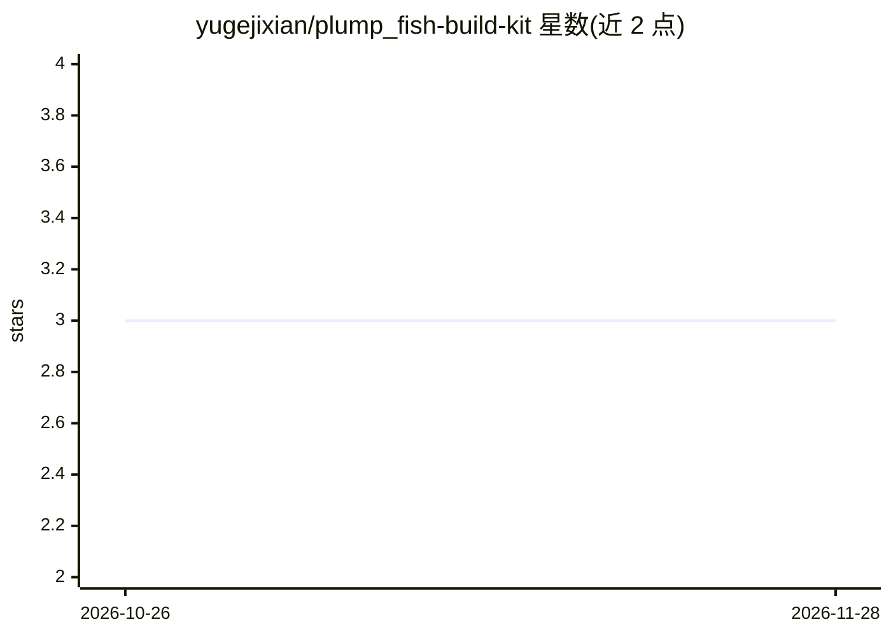

# yugejixian/plump_fish-build-kit

⭐ 3 · PowerShell · MIT · 推送 2026-10-19 · [GitHub](https://github.com/yugejixian/plump_fish-build-kit) · 个人维护 · 中文 README

**给 DeepSeek Harness 用户一键接入本地 Qwen3-VL 视觉模型的安装器**

面向已安装 DeepSeek Harness 的 Windows 机器，一键安装本地运行的 Qwen3-VL 视觉模型（经 llama.cpp 运行），装后在 DSH 模型列表出现 local-gguf/local-vl，可看图和委派批量文字任务。安装器提供离线包安装、SHA256 校验、.bak 回滚卸载、CUDA/Vulkan/CPU 三套构建探测与按显存选 4B/2B，并捆绑 4 个社区插件。仓库只含安装器/网关/界面源码，不含模型权重与 llama.cpp 二进制。仅支持 Windows，声明为实验性项目。

## 筛选速览

| 维度 | 判定 | 备注 |
|---|---|---|
| AI 角色 | `ai-ecosystem` | LLM/agent 周边工具 |
| 许可风险 | `permissive` | MIT |
| 部署形态 | `desktop` | 安装包/桌面程序 |
| 模型依赖 | local-ok | 支持本地模型 |
| 硬件要求 | — | 无带数字的原话,不猜 |
| 安装摩擦 | `medium` | 含编译或系统依赖之一 |
| 成熟度 | `idea` | |

## 能力要点

- 离线安装：模型、运行时、插件都在包内，安装不联网
- verify.ps1 逐文件 SHA256 校验，manifest.json 记录上游哈希
- CUDA/Vulkan/CPU 自动探测，按显存挑 4B 或 2B
- 可回滚卸载：所有改动带 .bak，不删用户自己的插件

## 适用场景

- 为已装 DeepSeek Harness 的 Windows 机器添加本地视觉模型能力
- 断网环境下离线部署本地视觉模型
- 需要可回滚、可校验的模型安装方案

## 场景标签

`模型网关` `多模态` · 领域:Agent 开发

## 证据(README 行号)

> L9: 给已经装好 DeepSeek Harness（DSH）的 Windows 机器，一键加一个
> L21: |硬件自适应|探测 CUDA / Vulkan / CPU 三套构建，按显存挑 4B 或 2B|
> L90: 实验性项目。安装器在 Windows 10/11 + DSH 0.2.x 上验证过；欢迎 issue/PR。

## 星数曲线

2026-10-26 3 → 2026-11-28 3（+0）

---
*卡片 v1 · prompt 1.4 · 生成 2026-11-21 · 置信度 high · 依据 README sha `97bf1a8f1672` · [字段定义](../../DATASET.md)*
