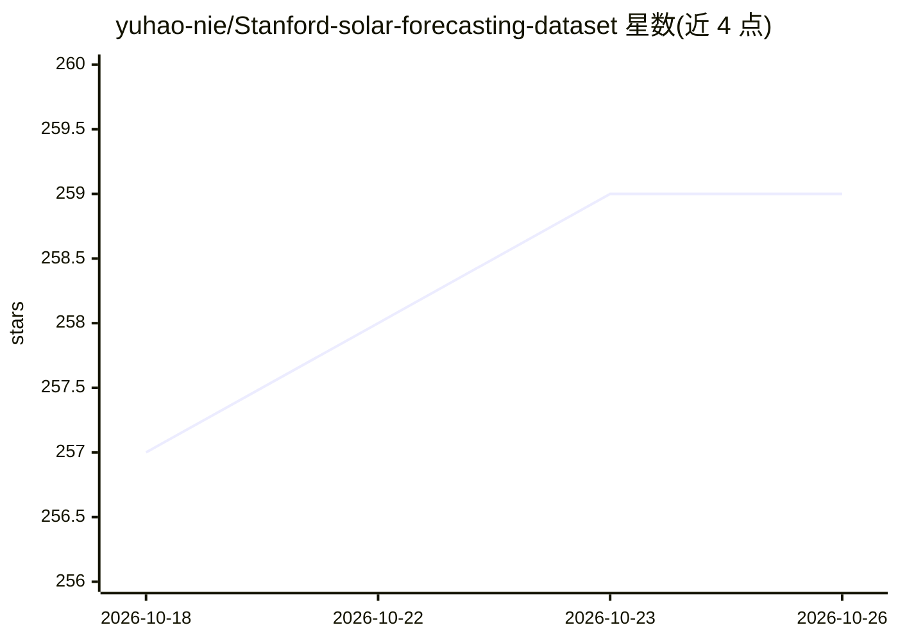

# yuhao-nie/Stanford-solar-forecasting-dataset

⭐ 259 · Jupyter Notebook · MIT · 推送 2026-10-07 · [GitHub](https://github.com/yuhao-nie/Stanford-solar-forecasting-dataset) · 组织维护

**斯坦福天空图像与光伏功率数据集：短期太阳能预测研究**

由斯坦福 EAO 课题组发布的 SKIPP'D 数据集，含两级数据：2017-2019 年处理好的基准集（64×64 天空图像 + 同步 1 分钟间隔光伏功率，HDF5 格式）与高分辨率原始集（2048×2048 鱼眼相机天空视频与图像、原始 PV 数据），在斯坦福校园采集，共开放 3 年数据。另提供 Python 数据处理与 SUNSET 基线模型的 Jupyter Notebook 代码（TensorFlow 2.4.1 实现）。基准数据托管于 Stanford PURL 与 Hugging Face，数据采用 CC BY 4.0、代码 MIT 许可。

## 筛选速览

| 维度 | 判定 | 备注 |
|---|---|---|
| AI 角色 | `ai-knowledge` | 知识聚合/清单类 |
| 许可风险 | `permissive` | MIT |
| 部署形态 | `None` |  |
| 模型依赖 | — | README 未给出锁定关系 |
| 硬件要求 | — | 无带数字的原话,不猜 |
| 安装摩擦 | `medium` | 含编译或系统依赖之一 |
| 成熟度 | — | 结构信号不足 |

## 能力要点

- 3 年基准数据：64×64 天空图像与 1 分钟间隔 PV 功率配对，HDF5 格式即取即用
- 原始数据含 2048×2048、20fps 天空视频与 1 分钟间隔原始 PV 记录
- 附数据处理与 SUNSET nowcast/forecast 基线模型 Jupyter Notebook
- 基准数据可通过 Hugging Face Datasets 库访问

## 适用场景

- 开发和基准测试基于深度学习的短期光伏功率预测模型
- 研究天空图像分割、云类型分类与云运动预测
- 复现 SUNSET 等相关工作或自定义数据提取流程

## 场景标签

`图像视频处理` `目标检测` · 领域:感知与多模态

## 证据(README 行号)

> L23: Here, we present **SKIPP'D** — a **SK**y **I**mages and **P**hotovoltaic **P**ower Generation **D**ataset for short
> L65: 1. Benchmark dataset: 3 years of processed sky images (64×64) and concurrent PV power generation data with

## 星数曲线

2026-10-18 257 → 2026-10-26 259（+2）

---
*卡片 v1 · prompt 1.4 · 生成 2026-10-22 · 置信度 high · 依据 README sha `0a8af5c4f738` · [字段定义](../../DATASET.md)*
