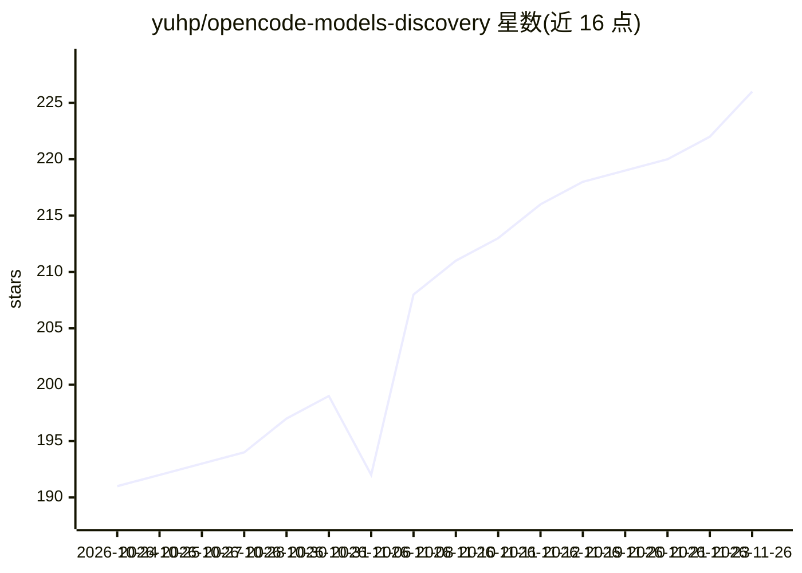

# yuhp/opencode-models-discovery

⭐ 226 · TypeScript · MIT · 推送 2026-11-25 · [GitHub](https://github.com/yuhp/opencode-models-discovery) · 个人维护

**OpenCode 插件：从 OpenAI 兼容提供商自动发现并注入模型**

面向 OpenCode 用户的插件：查询提供商的模型列表端点（默认 /v1/models），应用可选过滤后把发现的模型自动注入 OpenCode 配置。支持 OpenCode v2 的 plugins/providers 集成与 /connect 凭据管理，保留 v1 适配器。可选的元数据丰富功能按多种格式（aiproxy、litellm、ollama、vllm 等）读取模型限制、推理、工具等字段；缓存默认关闭。要求已安装支持插件的 OpenCode 及至少一个 OpenAI 兼容提供商。

## 筛选速览

| 维度 | 判定 | 备注 |
|---|---|---|
| AI 角色 | `ai-ecosystem` | LLM/agent 周边工具 |
| 许可风险 | `permissive` | MIT |
| 部署形态 | `None` |  |
| 模型依赖 | local-ok | 支持本地模型 |
| 硬件要求 | — | 无带数字的原话,不猜 |
| 安装摩擦 | `low` | 无编译、无系统依赖或容器化 |
| 成熟度 | — | 结构信号不足 |

## 能力要点

- 从 /v1/models 或自定义端点动态发现模型并注入 OpenCode
- 提供商级启用开关、端点覆盖、超时与模型过滤
- 可选元数据丰富：限制、reasoning、tools、attachments、结构化输出等字段
- v2 提供 /models-discovery-refresh、/models-discovery-console 命令与 agent 工具

## 适用场景

- 让 OpenCode 自动发现本地 Ollama/vLLM/LM Studio 提供的模型
- 多个 OpenAI 兼容提供商统一接入 OpenCode 时免去手动登记模型
- 通过过滤规则只暴露特定模型子集给 OpenCode

## 场景标签

`模型网关` · 领域:Agent 开发

## 证据(README 行号)

> L10: > Discover models from OpenAI-compatible providers and add them to OpenCode automatically.
> L12: This plugin queries a provider's model endpoint, applies optional filters, and injects the discovered models into O

## 星数曲线

2026-10-24 191 → 2026-11-26 226（+35）

---
*卡片 v1 · prompt 1.4 · 生成 2026-11-25 · 置信度 high · 依据 README sha `f865ecb46395` · [字段定义](../../DATASET.md)*
