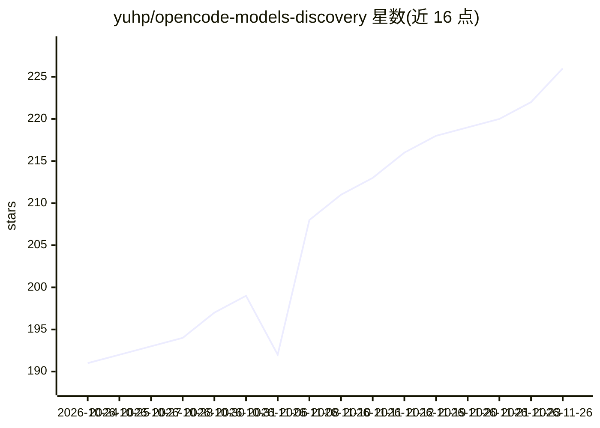

# yuhp/opencode-models-discovery

⭐ 226 · TypeScript · MIT · 推送 2026-11-25 · [GitHub](https://github.com/yuhp/opencode-models-discovery) · 个人维护

**OpenCode 插件：自动发现 OpenAI 兼容供应商的模型列表**

面向 OpenCode 用户的插件：查询供应商的 /v1/models 端点，应用可选过滤器，把发现的模型自动注入 OpenCode。支持 OpenCode v2（主要集成路径，含 /connect 凭据、主机存储、刷新命令与模型控制台），并保留 v1 适配器用于旧配置。提供供应商级启用开关、端点覆盖、超时与模型过滤；元数据丰富为可选功能，支持 aiproxy、litellm、ollama、vllm、openrouter 等格式。通过 npm 分发，MIT 许可，非 OpenCode 官方构建。

## 筛选速览

| 维度 | 判定 | 备注 |
|---|---|---|
| AI 角色 | `ai-ecosystem` | LLM/agent 周边工具 |
| 许可风险 | `permissive` | MIT |
| 部署形态 | `None` |  |
| 模型依赖 | local-ok | 支持本地模型 |
| 硬件要求 | — | 无带数字的原话,不猜 |
| 安装摩擦 | `low` | 无编译、无系统依赖或容器化 |
| 成熟度 | — | 结构信号不足 |

## 能力要点

- 从 /v1/models 或自定义端点动态发现模型并注入 OpenCode
- 供应商级启用、端点覆盖、超时与 include/exclude 过滤
- 可选元数据丰富，支持 10 种格式（litellm/ollama/vllm/openrouter 等）
- v2 提供 /models-discovery-refresh、/models-discovery-console 命令与 agent 工具

## 适用场景

- 本地运行 Ollama/vLLM 时自动把模型列表接入 OpenCode
- 多个 OpenAI 兼容供应商场景下统一发现并管理模型
- 需要人类可读模型名与 limits/tools 等元数据补充的配置

## 场景标签

 · 领域:LLM 基础设施/模型接入

## 证据(README 行号)

> L10: > Discover models from OpenAI-compatible providers and add them to OpenCode automatically.
> L12: This plugin queries a provider's model endpoint, applies optional filters, and injects the discovered models into O

## 星数曲线

2026-10-24 191 → 2026-11-26 226（+35）

---
*卡片 v1 · prompt 1.4 · 生成 2026-11-26 · 置信度 high · 依据 README sha `c57385eef3c7` · [字段定义](../../DATASET.md)*
