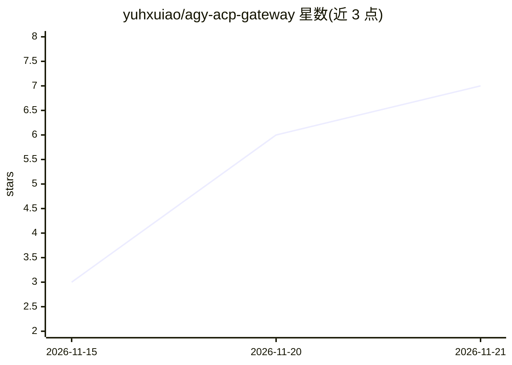

# yuhxuiao/agy-acp-gateway

⭐ 7 · Go · MIT · 推送 2026-11-20 · [GitHub](https://github.com/yuhxuiao/agy-acp-gateway) · 个人维护

**为开发者把 Antigravity CLI 变成多协议 API 网关**

单二进制纯 Go（CGO_ENABLED=0）实现，构建于 Google 官方 Antigravity CLI（agy acp，stdio 上的 JSON-RPC 2.0）之上，提供四协议端点转换（/v1/messages、/v1/chat/completions、/v1/responses、/v1beta generateContent）及实时可观测套件。机制包括每轨迹 sessionID 二进制补丁、预填充软分离与 Singleflight、MCP 工具桥与兄弟调用批处理、三段式语义洁净室与 HMAC 编解码、SQLite 遥测读取与 Prometheus 指标、隔离端口的仪表盘。要求 Go 1.26+，依赖本地 agy 二进制。

## 筛选速览

| 维度 | 判定 | 备注 |
|---|---|---|
| AI 角色 | `ai-ecosystem` | LLM/agent 周边工具 |
| 许可风险 | `permissive` | MIT |
| 部署形态 | `self-host` | docker 或自建部署 |
| 模型依赖 | — | README 未给出锁定关系 |
| 硬件要求 | — | 无带数字的原话,不猜 |
| 安装摩擦 | `low` | 无编译、无系统依赖或容器化 |
| 成熟度 | — | 结构信号不足 |

## 能力要点

- 四协议端点（Anthropic/OpenAI Responses/OAI Chat/Gemini v1beta）统一转换
- 5 层 KV 缓存防御：per-trajectory sessionID 补丁与前缀冻结
- 3 段式语义洁净室 + 可逆 HMAC 编解码 + WAF 自动二分隔离
- SQLite 遥测读取、Prometheus /metrics 与独立端口仪表盘

## 适用场景

- 让 Claude Code、Cursor 等编码 agent 通过本地网关使用 agy acp
- 生产环境下监控配额窗口、缓存命中与模型路由变化
- 需要结构化输出与 tool_choice 控制的多客户端接入

## 场景标签

`模型网关` `LLM 可观测性` · 领域:Agent 开发

## 证据(README 行号)

> L20: **agy-acp-gateway** is a single-binary, pure-Go (`CGO_ENABLED=0`) multi-protocol API gateway and real-time observab
> L82: |**`:18890`** (`AGY_GW_PORT`)|**Inference API & Liveness**|`POST /v1/messages`, `POST /v1/messages/count_tokens`, `

## 星数曲线

2026-11-15 3 → 2026-11-21 7（+4）

---
*卡片 v1 · prompt 1.4 · 生成 2026-11-20 · 置信度 high · 依据 README sha `beafc715248d` · [字段定义](../../DATASET.md)*
