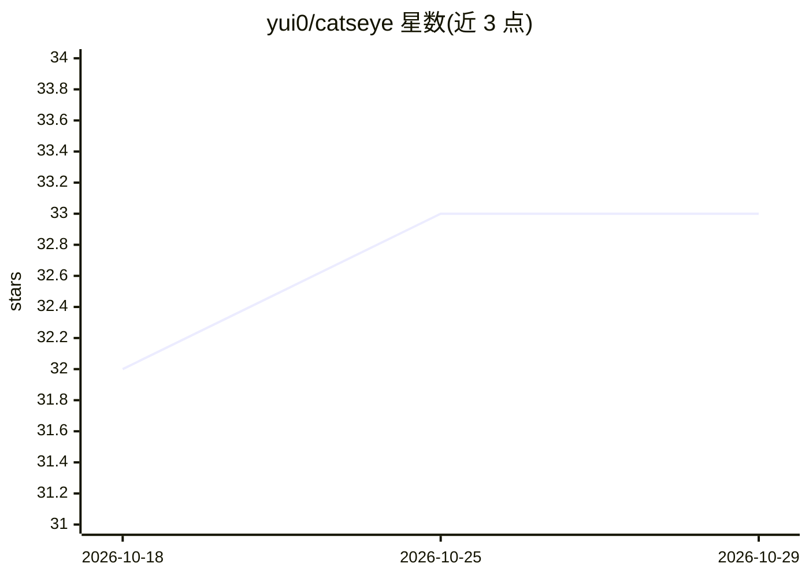

# yui0/catseye

⭐ 33 · C · 推送 2026-10-27 · [GitHub](https://github.com/yui0/catseye) · 个人维护 · 中文 README

**单头文件 C 神经网络库及示例应用集**

以 header-only 形式提供的 C 语言神经网络库：include catseye.h 即可在 C 项目中编写模型，无需安装依赖。支持多种激活/损失函数、SGD/Momentum/AdaGrad/RMSProp/Adam 优化器、卷积/反卷积/池化/批归一化等层类型，可读取 PNG/CIFAR/MNIST 数据。另含 GGUF/LLM 推理运行时头文件、语音转录 CLI 及 GAN/自编码器/超分辨率/word2vec 等示例。GPGPU（OpenCL/OpenGL）部分标注为开发中。给想在 C 中直接实现和训练神经网络的开发者使用。

## 筛选速览

| 维度 | 判定 | 备注 |
|---|---|---|
| AI 角色 | `ai-native` | 本体是模型或模型工具 |
| 许可风险 | `none` | — |
| 部署形态 | `None` |  |
| 模型依赖 | — | README 未给出锁定关系 |
| 硬件要求 | — | 无带数字的原话,不猜 |
| 安装摩擦 | `medium` | 含编译或系统依赖之一 |
| 成熟度 | `idea` | |

## 能力要点

- header-only 单文件设计，include 即用、无安装依赖
- 支持 MLP/卷积/反卷积/子像素卷积/池化/批归一化等层与五种优化器
- 读取 PNG/CIFAR/MNIST 格式并含数据增强（噪声/缩放/平移）
- 附 GGUF/LLM 推理运行时头文件与语音转录 CLI

## 适用场景

- 在 C 项目中手写并训练 CNN/MLP 模型
- 跑 MNIST/CIFAR-10 手写数字与图像识别示例
- 学习反向传播、自编码器与 GAN 的 C 语言实现

## 场景标签

`模型训练` `推理引擎` · 领域:训练与推理

## 证据(README 行号)

> L3: Neural network library and applications in C.
> L22: - Lightweight and minimalistic:
> L24:  - Just include catseye.h and write your model in c. There is nothing to install.

## 星数曲线

2026-10-18 32 → 2026-10-29 33（+1）

---
*卡片 v1 · prompt 1.4 · 生成 2026-10-25 · 置信度 high · 依据 README sha `64ff51b8094c` · [字段定义](../../DATASET.md)*
