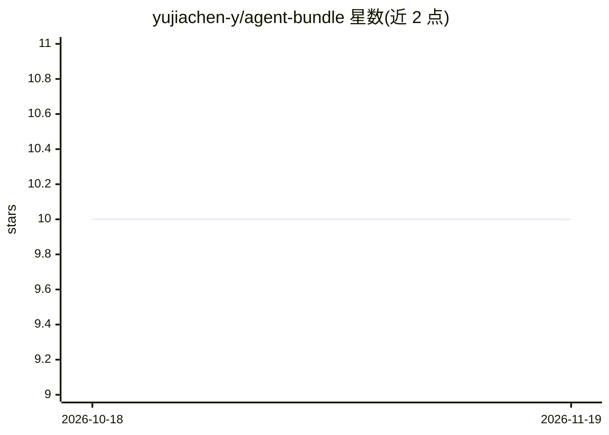

# yujiachen-y/agent-bundle

⭐ 10 · TypeScript · MIT · 推送 2026-10-28 · [GitHub](https://github.com/yujiachen-y/agent-bundle) · [官网](https://agent-bundle.com/) · 个人维护

**把 YAML 定义的 agent 技能打包为可部署服务的构建 CLI**

面向开发者的 agent 构建工具链：用一份 YAML 声明技能、模型提供方与沙箱后端，经 Prisma 风格的 generate 命令产出带类型定义的 TypeScript 包，以普通依赖导入自己的 Hono/Express/Fastify 服务。支持 E2B 与 Kubernetes 沙箱执行、token 作用域的 MCP 数据访问、dev/serve/build 共用沙箱抽象保证环境一致，另提供本地 WebUI 查看 agent 文件树、LLM 转录与 token 用量，并支持 OpenTelemetry 追踪与 AWS ECS Fargate 部署（beta）。MIT 许可，Node.js 生态。

## 筛选速览

| 维度 | 判定 | 备注 |
|---|---|---|
| AI 角色 | `ai-ecosystem` | LLM/agent 周边工具 |
| 许可风险 | `permissive` | MIT |
| 部署形态 | `library` | 以包/库形式分发 |
| 模型依赖 | local-ok | 支持本地模型 |
| 硬件要求 | — | 无带数字的原话,不猜 |
| 安装摩擦 | `low` | 无编译、无系统依赖或容器化 |
| 成熟度 | — | 结构信号不足 |

## 能力要点

- YAML 单文件定义，生成带类型检查的 TypeScript agent 包
- E2B 与 Kubernetes 沙箱，dev/serve/build 共用同一沙箱抽象
- Token 作用域 MCP：prompt 注入下不超出 token 权限
- 本地 WebUI 查看转录、token 用量与工具调用指标，支持 OpenTelemetry

## 适用场景

- 把本地编码 agent 里验证过的技能以声明式配置发布到生产服务
- 在无 API key 的本地环境用 Ollama 开发，再一行切换到云端模型
- 通过 WebUI 观察 agent 运行时的文件操作与 LLM 调用明细
- 用 MCP token 作用域限制 agent 对内部服务的访问边界

## 场景标签

`Agent 框架` · 领域:Agent 开发

## 证据(README 行号)

> L11: > Define agent skills in YAML. Generate a production-ready agent service.
> L58: |**Generate**|Hand-wire LLM calls, no type safety|`npx agent-bundle generate` — typed factory you can import like a
> L160: The agent orchestrator routes between the LLM provider, sandbox, and MCP servers. All three interfaces share the s

## 星数曲线

2026-10-18 10 → 2026-11-19 10（+0）

---
*卡片 v1 · prompt 1.4 · 生成 2026-11-19 · 置信度 high · 依据 README sha `c8b580074f1d` · [字段定义](../../DATASET.md)*
