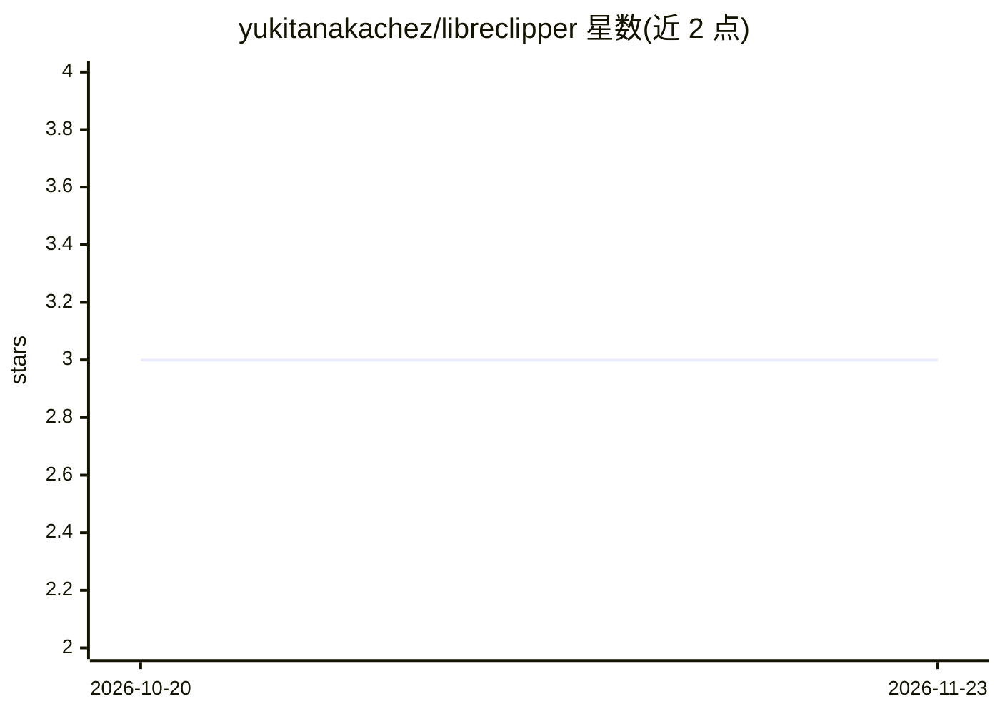

# yukitanakachez/libreclipper

⭐ 3 · Python · MIT · 推送 2026-10-12 · [GitHub](https://github.com/yukitanakachez/libreclipper) · 个人维护

**本地运行的播客切片工具：长视频生成竖屏短片**

开源播客切片工具，在本地计算机运行：输入长视频，自动挑选片段并渲染为带逐词字幕、标题和创作者署名的竖屏短片，面向 TikTok/Reels/Shorts 发布。AI 选择片段需配置 AI provider 的 API key；转录（Whisper）、人脸跟踪（MediaPipe）与渲染（FFmpeg）全部在本地执行。需要 Apple Silicon Mac（M1 及以上），通过 git clone 后运行 ./start 启动，首次运行约下载 1GB 依赖，无需系统级安装，删除文件夹即完全移除。

## 筛选速览

| 维度 | 判定 | 备注 |
|---|---|---|
| AI 角色 | `ai-native` | 本体是模型或模型工具 |
| 许可风险 | `permissive` | MIT |
| 部署形态 | `None` |  |
| 模型依赖 | locked-api |  |
| 硬件要求 | — | 无带数字的原话,不猜 |
| 安装摩擦 | `medium` | 含编译或系统依赖之一 |
| 成熟度 | — | 结构信号不足 |

## 能力要点

- AI 挑选片段，用户审核后才渲染
- 裁剪跟随说话人，逐词字幕、标题与署名烧录
- 转录、人脸跟踪、渲染全部本地执行，不上传内容
- Campaigns YAML 为单个创作者预设字幕、时长、音乐等默认值

## 适用场景

- 把播客长视频切成竖屏短片发 TikTok/Reels/Shorts
- 点击转录文本中的词来修剪片段起止点
- 为多位创作者维护各自的字幕、话题标签与署名预设

## 场景标签

`语音识别` `图像视频处理` · 领域:感知与多模态

## 证据(README 行号)

> L8: - **AI picks the moments.** You review them before anything renders.
> L11: - **Everything else is local.** Transcription, face tracking and rendering run on your
> L16: You need an Apple Silicon Mac (M1 or later) with `git`, and an API key from an AI provider

## 星数曲线

2026-10-20 3 → 2026-11-23 3（+0）

---
*卡片 v1 · prompt 1.4 · 生成 2026-11-21 · 置信度 high · 依据 README sha `d146b7ce4747` · [字段定义](../../DATASET.md)*
