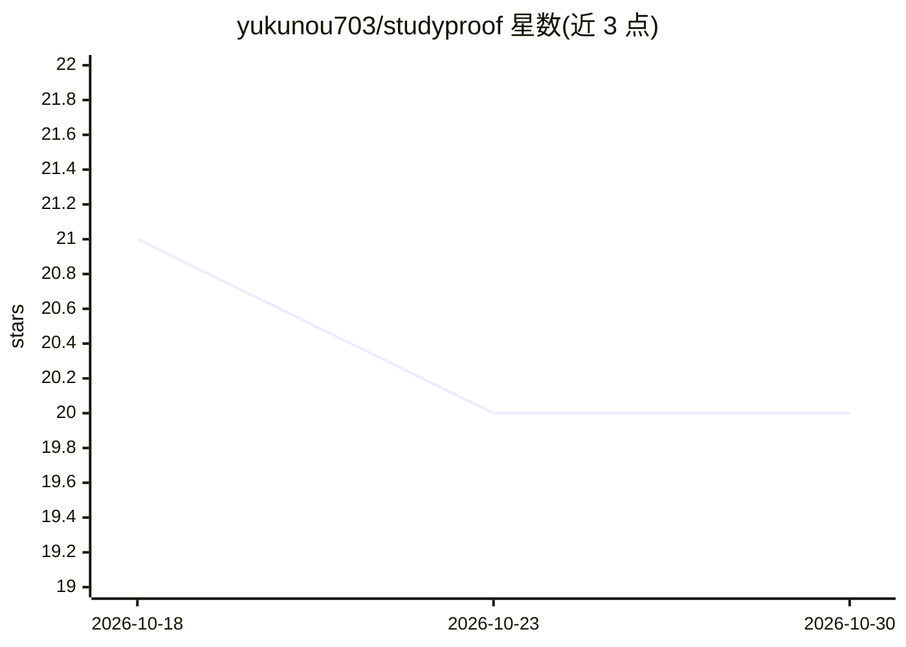

# yukunou703/studyproof

⭐ 20 · Python · MIT · 推送 2026-09-07 · [GitHub](https://github.com/yukunou703/studyproof) · 个人维护

**本地证据工作台：整理论文笔记、打包 AI 上下文并核验引文**

面向研究者与学生的本地资料工作台：导入 PDF/Markdown/文本，用 SQLite BM25 关键词检索相关段落，导出带引用 ID（如 [S1]）、来源哈希与位置信息的 Markdown 上下文包及 JSON 审计文件给 AI 助手；再核验回答中的引文是否确实出现在该包中，报告缺失引用、未知 ID 与措辞改动。无需账号、API key、嵌入模型或 GPU，库文件保存在本机。提供 CLI、浏览器界面（绑定 127.0.0.1）与基于官方 MCP SDK 的只读适配器。检索只匹配词面不做语义扩展，PDF 需文本层。

## 筛选速览

| 维度 | 判定 | 备注 |
|---|---|---|
| AI 角色 | `ai-ecosystem` | LLM/agent 周边工具 |
| 许可风险 | `permissive` | MIT |
| 部署形态 | `library` | 以包/库形式分发 |
| 模型依赖 | — | README 未给出锁定关系 |
| 硬件要求 | — | 无带数字的原话,不猜 |
| 安装摩擦 | `low` | 无编译、无系统依赖或容器化 |
| 成熟度 | — | 结构信号不足 |

## 能力要点

- BM25 关键词检索本地 PDF/Markdown/文本库，无需嵌入模型或 GPU
- 导出带引用 ID、来源哈希与页/行位置的上下文包和 JSON 审计文件
- 核验回答引文：匹配原文、缺失引用、未知 ID、措辞改动
- 通过官方 MCP Python SDK 暴露只读的列表/搜索/打包接口

## 适用场景

- 把课程讲义和论文整理成可检索的本地资料库
- 为 AI 学习助手准备带引用编号的上下文包
- 检查 AI 回答中的引用是否真的出自给定资料
- 为不同课程或项目用 --db 维护独立的资料库

## 场景标签

`知识库管理` `科研工具` · 领域:知识与检索

## 证据(README 行号)

> L9: StudyProof is a local evidence workbench for researchers and students. Add PDFs,
> L11: pack for your AI assistant, and check whether quotations in its answer actually
> L91: The optional adapter exposes read-only source listing, search, and context-pack

## 星数曲线

2026-10-18 21 → 2026-10-30 20（-1）

---
*卡片 v1 · prompt 1.4 · 生成 2026-10-28 · 置信度 high · 依据 README sha `2fd0b0c29a16` · [字段定义](../../DATASET.md)*
