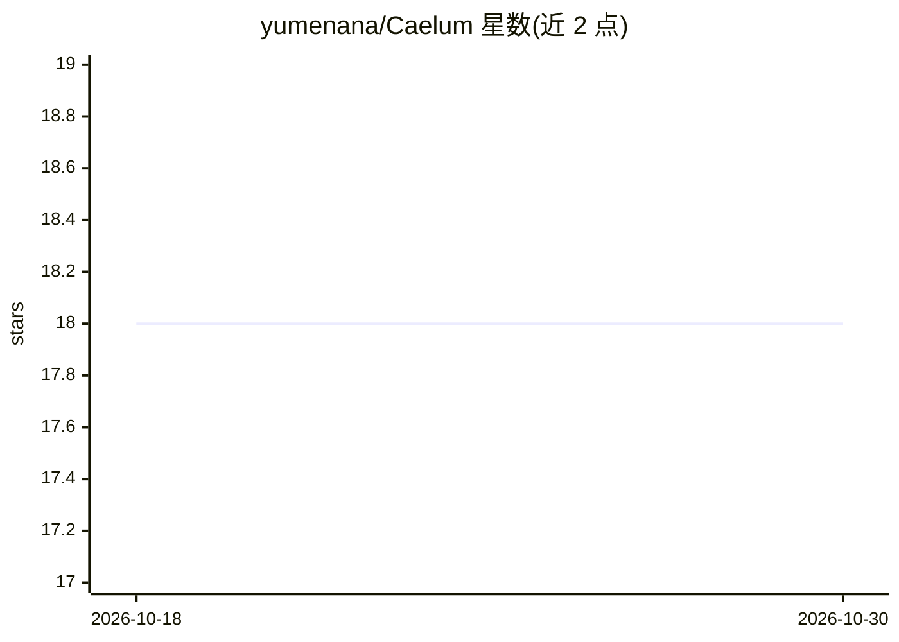

# yumenana/Caelum

⭐ 18 · Python · NOASSERTION · 推送 2026-09-05 · [GitHub](https://github.com/yumenana/Caelum) · 个人维护 · 中文 README

**面向网络压缩退化的动漫插画 4× 超分与压缩伪影修复工具**

针对 Pixiv/X/Facebook 等多平台转载链造成的模糊与 JPEG/WebP 压缩退化，提供 ×4 超分重建。模型为 PPBUNet（U-Net 金字塔 + HAT 注意力 + 方向旁路等），训练数据通过在线模拟多平台再上传退化链生成；推理走 ONNX + DirectML，无 DX12 GPU 时回退 CPU。以 Windows 原生 GUI（.exe）形式分发，需另下模型权重包，运行依赖 .NET 10 Desktop Runtime。项目声明仍在训练中，量化指标将随首个稳定版发布。

## 筛选速览

| 维度 | 判定 | 备注 |
|---|---|---|
| AI 角色 | `ai-native` | 本体是模型或模型工具 |
| 许可风险 | `none` | NOASSERTION |
| 部署形态 | `desktop` | 安装包/桌面程序 |
| 模型依赖 | — | README 未给出锁定关系 |
| 硬件要求 | — | 无带数字的原话,不猜 |
| 安装摩擦 | `medium` | 含编译或系统依赖之一 |
| 成熟度 | `idea` | |

## 能力要点

- ×4 超分，针对多平台互联网再上传退化链训练（非扩散生成，定位为修复）
- PPBUNet 架构：两级 U-Net + ParallelOAM 方向旁路 + HAT 注意力
- Windows 原生 GUI，DirectML 推理，无 GPU 时回退 CPU
- 13 项子损失两阶段渐进激活的训练设计

## 适用场景

- 修复经多次转载压缩的动漫插画并放大 4 倍
- 去除 Web 图片的 JPEG/WebP 压缩伪影
- 用现成 GUI 修图，无需配置 Python 环境

## 场景标签

`图像视频处理` · 领域:感知与多模态

## 证据(README 行号)

> L25: This is a **×4 super-resolution reconstruction network** specifically targeting real-world internet image degradati
> L48: - ⚡ **×4 Upscaling** — Dedicated 4× super-resolution reconstruction

## 星数曲线

2026-10-18 18 → 2026-10-30 18（+0）

---
*卡片 v1 · prompt 1.4 · 生成 2026-10-29 · 置信度 high · 依据 README sha `e3fcc7923049` · [字段定义](../../DATASET.md)*
