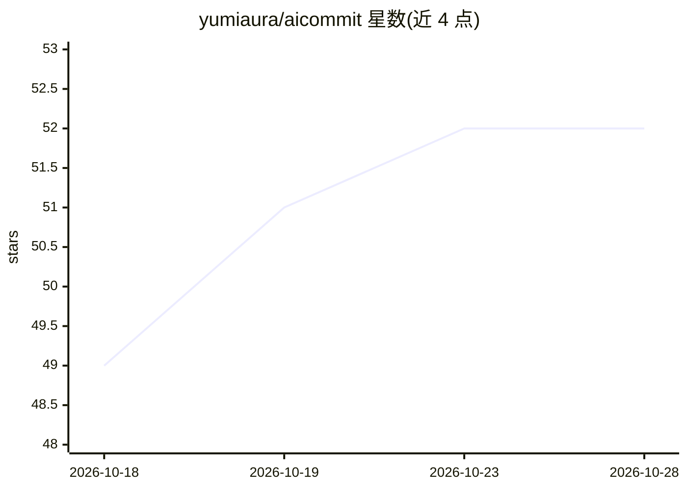

# yumiaura/aicommit

⭐ 52 · Python · MIT · 推送 2026-07-27 · [GitHub](https://github.com/yumiaura/aicommit) · [官网](https://github.com/yumiaura/AICommit) · 个人维护

**本地 LLM 生成 Conventional Commits 提交信息的 git 子命令工具**

Python 编写的 git 提交信息生成 CLI：读取 staged diff，调用本地 LLM（默认 Ollama，或以 llama-cpp-python 内嵌 GGUF 模型）生成 Conventional Commits 格式的提交信息，在 $EDITOR 中走 approve/edit/regenerate 循环；支持 changelog 子命令汇总 tag 区间写入 CHANGELOG.md、--print 管道到剪贴板、--review 审查模式。零运行时依赖（仅 Python 标准库）用于 Ollama 后端，配置走 TOML/env/CLI 多级覆盖。需 Python 3.11+ 和一个本地 LLM 后端。

## 筛选速览

| 维度 | 判定 | 备注 |
|---|---|---|
| AI 角色 | `ai-ecosystem` | LLM/agent 周边工具 |
| 许可风险 | `permissive` | MIT |
| 部署形态 | `library` | 以包/库形式分发 |
| 模型依赖 | local-ok | 支持本地模型 |
| 硬件要求 | — | 无带数字的原话,不猜 |
| 安装摩擦 | `low` | 无编译、无系统依赖或容器化 |
| 成熟度 | — | 结构信号不足 |

## 能力要点

- 从 staged diff 生成 Conventional Commits 信息
- 默认 Ollama 后端，可选 llama-cpp-python 内嵌 GGUF，离线无需 API key
- Ollama 后端零运行时依赖，仅 Python 标准库
- changelog 子命令汇总 tag 区间生成 CHANGELOG.md

## 适用场景

- 日常提交时让本地模型代拟规范化 commit message
- 发版时自动汇总 tag 区间生成变更日志
- 在离线/内网环境使用本地模型写提交信息

## 场景标签

`AI 写作` · 领域:内容生成

## 证据(README 行号)

> L3: Generate Conventional Commit messages from your staged diff, powered by a local LLM. No API keys. No cloud.
> L14: - Powered by a **local LLM** via Ollama (or `llama-cpp-python`)

## 星数曲线

2026-10-18 49 → 2026-10-28 52（+3）

---
*卡片 v1 · prompt 1.4 · 生成 2026-10-24 · 置信度 high · 依据 README sha `c5b4c6ca7462` · [字段定义](../../DATASET.md)*
