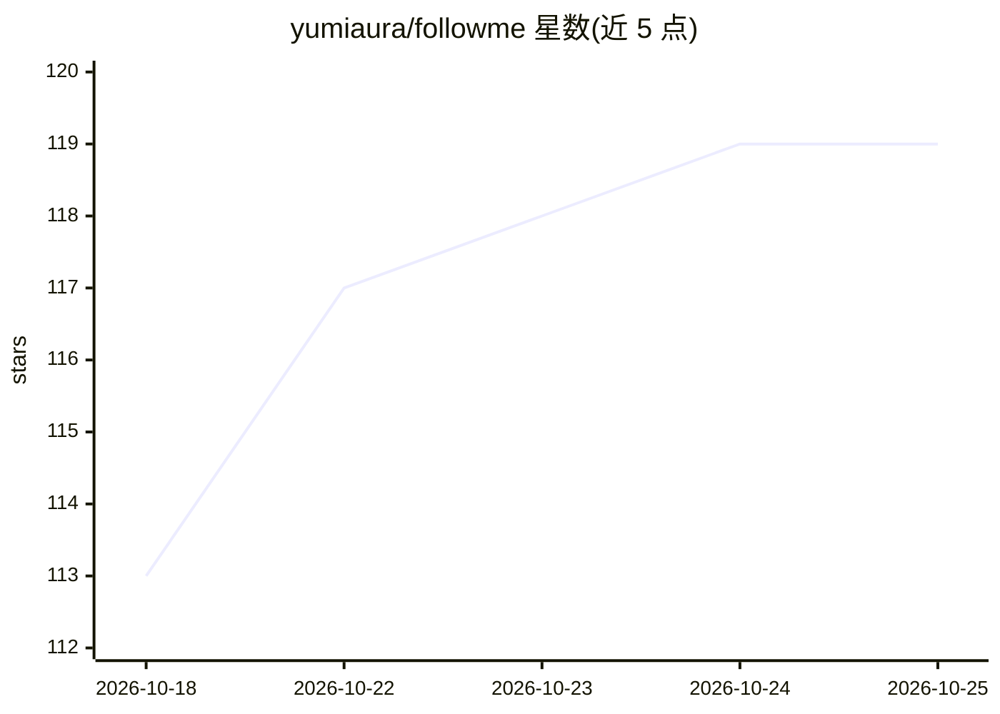

# yumiaura/followme

⭐ 121 · Python · 推送 2026-07-20 · [GitHub](https://github.com/yumiaura/followme) · 个人维护

**CLI 脚本集：本地 Ollama 模型给 GitHub 仓库打分并自动关注/加星**

由四个可独立运行的 Python 脚本与一个串联入口组成的 CLI 工具：从 GitHub Search 拉取仓库写入 SQLite，浅克隆后交由本地 Ollama 模型按 idea 与 skill 两维打 1.0–10.0 分并生成英文摘要，附带恶意行为筛查（凭据窃取、外传、混淆 RCE 等，命中即排除关注与加星）；随后按阈值自动 follow 高分作者、star 高分仓库，可单次或循环运行。仅用标准库，需 Git CLI、GitHub token 与本地 Ollama。

## 筛选速览

| 维度 | 判定 | 备注 |
|---|---|---|
| AI 角色 | `ai-ecosystem` | LLM/agent 周边工具 |
| 许可风险 | `none` | — |
| 部署形态 | `None` |  |
| 模型依赖 | local-ok | 支持本地模型 |
| 硬件要求 | — | 无带数字的原话,不猜 |
| 安装摩擦 | `low` | 无编译、无系统依赖或容器化 |
| 成熟度 | — | 结构信号不足 |

## 能力要点

- 四步流水线：fetch → evaluate → subscribe → star，可独立或循环运行
- Ollama 输出 idea/skill 双维 1.0–10.0 评分与恶意行为判定
- 恶意仓库强制降分为 1.0 并排除出关注/加星
- 状态存单一 SQLite 文件，仅依赖 Python 标准库

## 适用场景

- 自动化发现并筛选 GitHub 上高质量的仓库与作者
- 持续跟踪并关注/收藏评分达标的活跃项目
- 在关注前筛查仓库的恶意行为风险

## 场景标签

`工作流自动化` · 领域:效率与自动化

## 证据(README 行号)

> L3: A small set of standalone CLI scripts that discover GitHub repositories,
> L16: |`scripts/evaluate.py`|Clone unrated repos, ask Ollama for `idea`, `skill`, `description` + a malware verdict, stor

## 星数曲线

2026-10-18 113 → 2026-10-25 119（+6）

---
*卡片 v1 · prompt 1.4 · 生成 2026-10-23 · 置信度 high · 依据 README sha `c9a8a55e62c8` · [字段定义](../../DATASET.md)*
