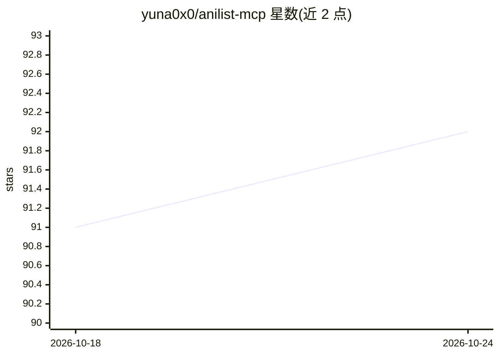

# yuna0x0/anilist-mcp

⭐ 92 · TypeScript · MIT · 推送 2026-07-13 · [GitHub](https://github.com/yuna0x0/anilist-mcp) · [官网](https://www.npmjs.com/package/anilist-mcp) · 个人维护

**给 LLM 客户端接入 AniList 动漫漫画数据的 MCP 服务器**

基于 Model Context Protocol 的服务器，封装 AniList API，向 LLM 客户端（如 Claude Desktop）提供动漫、漫画、角色、制作人员、工作室与用户数据的查询和交互能力：含约 30 个工具（搜索、详情获取、列表增删改、关注/收藏、活动与帖子管理等），支持高级过滤。提供 STDIO 与 HTTP 双传输方式，可本地运行、自托管或部署到 Smithery 等云平台。需登录的操作需配置 AniList API Token。要求 Node.js 18+，可用 pnpm 源码安装或 Docker 镜像运行。

## 筛选速览

| 维度 | 判定 | 备注 |
|---|---|---|
| AI 角色 | `ai-ecosystem` | LLM/agent 周边工具 |
| 许可风险 | `permissive` | MIT |
| 部署形态 | `self-host` | docker 或自建部署 |
| 模型依赖 | — | README 未给出锁定关系 |
| 硬件要求 | — | 无带数字的原话,不猜 |
| 安装摩擦 | `low` | 无编译、无系统依赖或容器化 |
| 成熟度 | — | 结构信号不足 |

## 能力要点

- 约 30 个工具覆盖搜索、媒体/角色/制作人员详情、用户列表增删改、活动与帖子管理
- STDIO 与 HTTP 双传输，支持本地、自托管与 Smithery 云部署
- 提供 Docker 镜像与多平台构建，支持 MCP Inspector 调试与 MCP Bundle 打包
- 登录操作通过 ANILIST_TOKEN 环境变量或 HTTP 头传递（可选）

## 适用场景

- 在 Claude Desktop 等 MCP 客户端中查询动漫、漫画与角色信息
- 让 LLM 代为管理我的 AniList 观看/阅读列表与收藏
- 自托管 HTTP 传输版供多个客户端访问 AniList 数据

## 场景标签

 · 领域:动漫/媒体数据 · LLM 工具接入

## 证据(README 行号)

> L3: A Model Context Protocol (MCP) server that interfaces with the AniList API, allowing LLM clients to access and inter
> L12: - **Dual transport support**: Both HTTP and STDIO transports

## 星数曲线

2026-10-18 91 → 2026-10-24 92（+1）

---
*卡片 v1 · prompt 1.4 · 生成 2026-10-23 · 置信度 high · 依据 README sha `96fed62a885b` · [字段定义](../../DATASET.md)*
