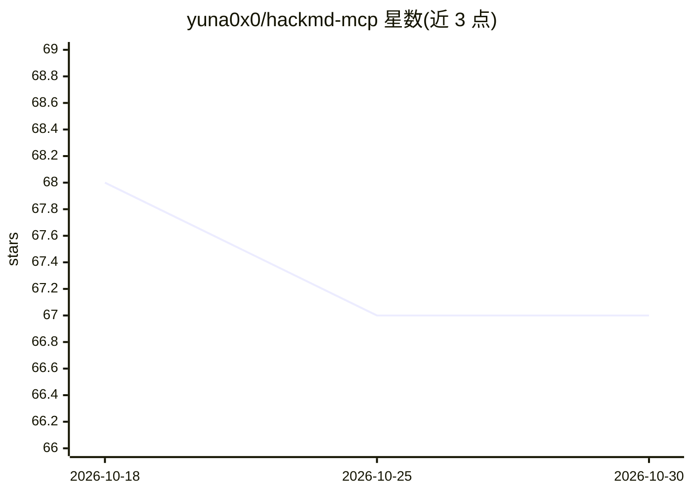

# yuna0x0/hackmd-mcp

⭐ 67 · TypeScript · MIT · 推送 2026-07-13 · [GitHub](https://github.com/yuna0x0/hackmd-mcp) · [官网](https://www.npmjs.com/package/hackmd-mcp) · 个人维护

**连接 HackMD 笔记平台的 MCP 服务器，供 LLM 客户端操作笔记**

基于 Model Context Protocol 的服务器，封装 HackMD API，使 Claude Desktop 等 LLM 客户端能够读写和管理 HackMD 笔记、团队笔记、用户资料与阅读历史。提供 13 个工具，覆盖笔记增删改查与团队协作；支持 STDIO 与 HTTP 双传输方式，可本地运行或部署到云端/Smithery 等平台。需 Node.js 18+ 与 HackMD API Token；提供 Docker 镜像与 MCP Inspector 调试流程。HTTP 托管时需自行保护预配置 Token 的端点。

## 筛选速览

| 维度 | 判定 | 备注 |
|---|---|---|
| AI 角色 | `ai-ecosystem` | LLM/agent 周边工具 |
| 许可风险 | `permissive` | MIT |
| 部署形态 | `self-host` | docker 或自建部署 |
| 模型依赖 | — | README 未给出锁定关系 |
| 硬件要求 | — | 无带数字的原话,不猜 |
| 安装摩擦 | `low` | 无编译、无系统依赖或容器化 |
| 成熟度 | — | 结构信号不足 |

## 能力要点

- 13 个工具覆盖笔记/团队/资料/历史的增删改查
- STDIO 与 HTTP 双传输，支持自托管与云部署
- Token 可经环境变量或 HTTP 头传入，头值优先
- 提供 Docker 镜像与 MCPB 打包命令

## 适用场景

- 在 Claude Desktop 等 MCP 客户端中直接管理我的 HackMD 笔记
- 通过对话让 AI 协作编辑团队笔记
- 自托管一个 HTTP MCP 服务供团队访问 HackMD

## 场景标签

 · 领域:AI 工具集成/笔记平台

## 证据(README 行号)

> L3: A Model Context Protocol (MCP) server that interfaces with the HackMD API, allowing LLM clients to access and intera
> L12: - **Dual transport support**: Both HTTP and STDIO transports

## 星数曲线

2026-10-18 68 → 2026-10-30 67（-1）

---
*卡片 v1 · prompt 1.4 · 生成 2026-10-24 · 置信度 high · 依据 README sha `bff13b4bf92a` · [字段定义](../../DATASET.md)*
