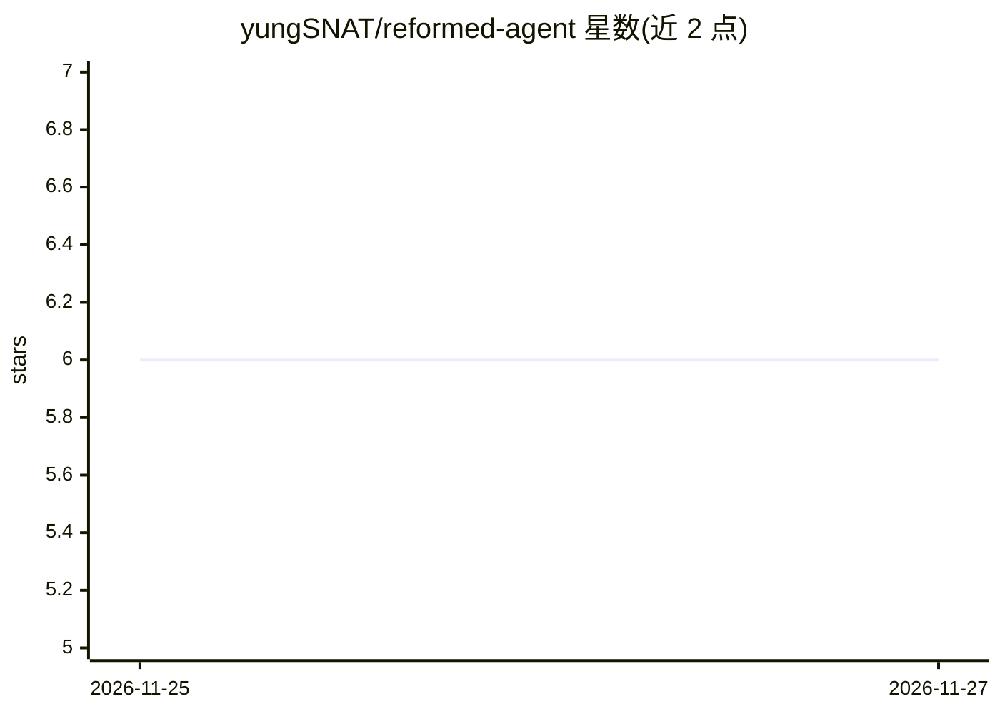

# yungSNAT/reformed-agent

⭐ 6 · Rust · NOASSERTION · 推送 2026-11-26 · [GitHub](https://github.com/yungSNAT/reformed-agent) · 个人维护

**面向开发者的 Rust 自治 agent 运行时，Hermes Agent 移植版**

以功能对齐为目标，将 NousResearch/Hermes Agent 移植为 Rust 二进制，运行 agent 无需 Python 或 Node.js。保留 Ultra 的可靠性与运维控制层，提供 TUI 交互、一次性查询、网关模式（cron 与 HTTP webhook，可接 17 个聊天平台）、MCP/ACP/skills/子代理与 cron 调度；支持从 Hermes、Claude Code、Codex 迁移配置与记忆。目前仅有源码构建安装，fork 未发布 release。

## 筛选速览

| 维度 | 判定 | 备注 |
|---|---|---|
| AI 角色 | `ai-ecosystem` | LLM/agent 周边工具 |
| 许可风险 | `permissive` | NOASSERTION |
| 部署形态 | `self-host` | docker 或自建部署 |
| 模型依赖 | local-ok | 支持本地模型 |
| 硬件要求 | — | 无带数字的原话,不猜 |
| 安装摩擦 | `low` | 无编译、无系统依赖或容器化 |
| 成熟度 | — | 结构信号不足 |

## 能力要点

- 单个 Rust 二进制，运行 agent 无需 Python/Node.js 运行时
- 17 个内置聊天平台，经网关模式接入（Discord/Slack/Telegram 等）
- 从 Hermes/Claude Code/Codex/OpenClaw 导入配置、记忆与技能
- 源码安装前校验 release 资产的 SHA256 与 cosign 签名

## 适用场景

- 在无 Python/Node 环境的机器上运行终端 AI agent
- 把已有 Hermes/Claude Code/Codex 的配置和记忆迁到新运行时
- 通过网关把 agent 接入多个聊天平台并跑定时任务

## 场景标签

`编码 Agent` · 领域:编码与开发

## 证据(README 行号)

> L10: Rust-first autonomous agent runtime with functional parity goals against `NousResearch/hermes-agent`. Reformed Agen
> L131: |Cron, MCP, ACP, skills, subagents|Yes (`hermes-cron`, `hermes-mcp`, `hermes-acp`, `hermes-skills`, `delegation.rs
> L72: Gateway mode, in the foreground. Without chat platforms the gateway serves only cron jobs and HTTP webhooks; `herme

## 星数曲线

2026-11-25 6 → 2026-11-27 6（+0）

---
*卡片 v1 · prompt 1.4 · 生成 2026-11-24 · 置信度 mid · 依据 README sha `596dbd9ef209` · [字段定义](../../DATASET.md)*
