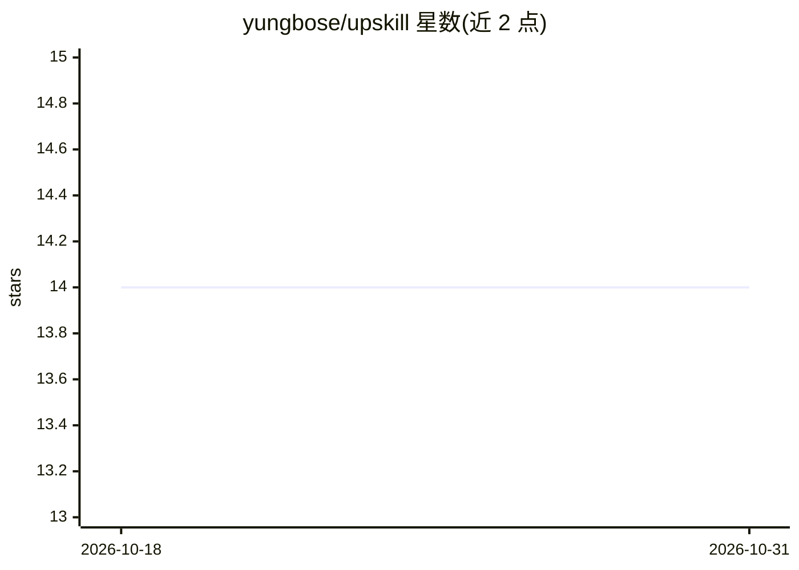

# yungbose/upskill

⭐ 14 · Python · MIT · 推送 2026-06-08 · [GitHub](https://github.com/yungbose/upskill) · 个人维护

**递归自我改进的 agent 技能系统：每次会话后复盘并沉淀修正**

upskill 本身是一个 Agent Skill，用于持续改进其他技能（含自身）。它在会话结束时运行 /upskill retro，检测哪些技能被调用，按结构化清单（纠正、成功、输出、流程）复盘会话，将教训写入各技能的 learnings.md（proposed/active/retired 生命周期），并通过两条毕业路径固化：程序性教训经 TDD 压力测试并入 SKILL.md，判断性教训交给 optimise-skill 做准则再训练。支持 npx skills add 一键安装，可手动拷贝到 ~/.claude/skills/。内置安全栏：不能自主编辑自身与信任链。

## 筛选速览

| 维度 | 判定 | 备注 |
|---|---|---|
| AI 角色 | `ai-ecosystem` | LLM/agent 周边工具 |
| 许可风险 | `permissive` | MIT |
| 部署形态 | `library` | 以包/库形式分发 |
| 模型依赖 | — | README 未给出锁定关系 |
| 硬件要求 | — | 无带数字的原话,不猜 |
| 安装摩擦 | `low` | 无编译、无系统依赖或容器化 |
| 成熟度 | — | 结构信号不足 |

## 能力要点

- 会话结束自动检测已运行技能并执行结构化复盘
- learnings.md 三态生命周期：proposed/active/retired
- 双毕业路径：程序性教训 TDD 压力测试入 SKILL.md，判断性教训走 rubric 再训练
- 安全栏：技能自身不能将自己的猜测提升为强制规则，也不能自主编辑自身

## 适用场景

- 让多个生产环境 agent 技能在每次会话后自动积累改进
- 把操作者反复纠正的行为固化为技能规则与测试
- 跨技能与项目级的教训归档与检索

## 场景标签

`提示工程` `Agent 记忆` · 领域:Agent 开发

## 证据(README 行号)

> L9: Skills only get better when three things line up: something obviously breaks, you remember to note what went wrong, 
> L34:     A["Run a session with\none or more skills"] --> B["/upskill retro reviews\nthe session at the end"]
> L83: |`/upskill <name>` (doesn't exist)|**Create**|Authors the skill via TDD behind a staging contract: stage to a temp 

## 星数曲线

2026-10-18 14 → 2026-10-31 14（+0）

---
*卡片 v1 · prompt 1.4 · 生成 2026-10-31 · 置信度 high · 依据 README sha `baa8b3b86f6c` · [字段定义](../../DATASET.md)*
