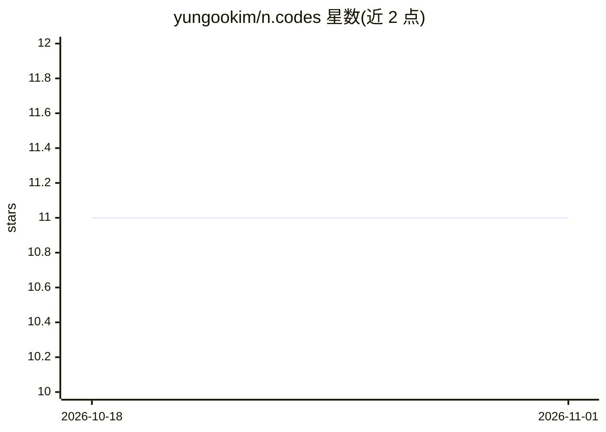

# yungookim/n.codes

⭐ 11 · JavaScript · MIT · 推送 2026-07-28 · [GitHub](https://github.com/yungookim/n.codes) · [官网](https://n.codes) · 个人维护

**让终端用户在应用内用 prompt 生成自定义 UI 组件的开源工具**

面向 SaaS 开发者的 agentic UI 库：扫描前端组件与后端 API/docs/schema 生成 capability map，用户输入 prompt 后据此在沙盒运行时生成保持应用风格一致的私有 UI 组件。不做任意代码执行，带 RBAC 权限与审计日志；定位为 CRUD、分析与工作流类需求。通过 npx ncodes init 安装，支持人工流程与 AI coding agent 两种接入方式，能力图生成需配置 LLM provider 与 API key。

## 筛选速览

| 维度 | 判定 | 备注 |
|---|---|---|
| AI 角色 | `ai-ecosystem` | LLM/agent 周边工具 |
| 许可风险 | `permissive` | MIT |
| 部署形态 | `library` | 以包/库形式分发 |
| 模型依赖 | — | README 未给出锁定关系 |
| 硬件要求 | — | 无带数字的原话,不猜 |
| 安装摩擦 | `low` | 无编译、无系统依赖或容器化 |
| 成熟度 | `idea` | |

## 能力要点

- 扫描前端组件与后端 API 生成 capability map
- 按用户 prompt 在沙盒运行时生成 UI 组件
- 无任意代码执行、RBAC 权限与审计日志
- 生成 UI 可私有、共享团队或提升为官方

## 适用场景

- 让客户自行生成自定义仪表盘或数据导出界面
- 消化积压的长尾小功能需求
- 在应用内为部分用户提供自动化构建能力

## 场景标签

`代码生成` · 领域:编码与开发

## 证据(README 行号)

> L68: I'm creating n.codes. It's an open-source project that lets users build the feature they need with just a prompt in
> L105: 3. Given the user's prompt, it uses the capability map to build the UI that the user asks for, and creates a priva

## 星数曲线

2026-10-18 11 → 2026-11-01 11（+0）

---
*卡片 v1 · prompt 1.4 · 生成 2026-11-01 · 置信度 high · 依据 README sha `d9c32afe3dd6` · [字段定义](../../DATASET.md)*
