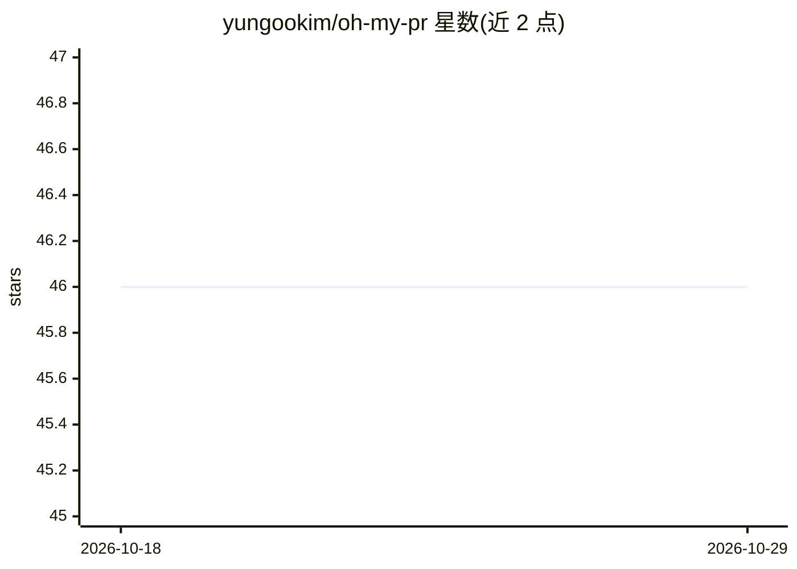

# yungookim/oh-my-pr

⭐ 46 · TypeScript · MIT · 推送 2026-08-21 · [GitHub](https://github.com/yungookim/oh-my-pr) · [官网](https://yungookim.github.io/oh-my-pr/) · 个人维护

**本地优先的 GitHub PR 看护工具：调度 Codex/Claude 代理自动修复**

运行在用户本机的 GitHub PR 监护工具：监视指定仓库和 PR 的评审评论与 CI 失败，把反馈整理为可执行项，在 ~/.oh-my-pr 下的隔离 git worktree 中调用本地 codex 或 claude CLI 生成修复并推回 PR 分支，还可代回复评论、自动创建 release。通过 web 仪表盘、本地 REST API 与 MCP server 暴露功能，提供 macOS Apple Silicon 桌面构建（未公证）。README 明示 token 消耗量大、会增加 AI 提供商成本。

## 筛选速览

| 维度 | 判定 | 备注 |
|---|---|---|
| AI 角色 | `ai-ecosystem` | LLM/agent 周边工具 |
| 许可风险 | `permissive` | MIT |
| 部署形态 | `library` | 以包/库形式分发 |
| 模型依赖 | — | README 未给出锁定关系 |
| 硬件要求 | — | 无带数字的原话,不猜 |
| 安装摩擦 | `low` | 无编译、无系统依赖或容器化 |
| 成熟度 | — | 结构信号不足 |

## 能力要点

- 监视 PR 评审评论与 CI 失败并分派 codex/claude CLI 在隔离 worktree 中修复
- 支持 web 仪表盘、本地 REST API 与 MCP server 三种接口
- 代码属主回退路径与有界 CI 治愈、Vercel/Railway 部署失败跟进修复（可选）
- 本地存储缓存/日志/状态，GitHub token 写日志前自动脱敏

## 适用场景

- 让 AI 代理自动处理 PR 评审意见和 CI 失败，把 PR 推向可合并状态
- 自动代为回复 GitHub 评论并 resolve 会话
- 通过仪表盘或 MCP 以自然语言查询被跟踪 PR 的状态

## 场景标签

`编码 Agent` `代码审查` · 领域:编码与开发

## 证据(README 行号)

> L11: oh-my-pr is a local-first GitHub PR babysitter. It watches the pull requests you care about, reads review feedback 
> L67: - Runs `codex` or `claude` in isolated worktrees under `~/.oh-my-pr`
> L74: - Exposes the same system through a dashboard, local API, and MCP server

## 星数曲线

2026-10-18 46 → 2026-10-29 46（+0）

---
*卡片 v1 · prompt 1.4 · 生成 2026-10-25 · 置信度 high · 依据 README sha `e0a5f9aea84b` · [字段定义](../../DATASET.md)*
