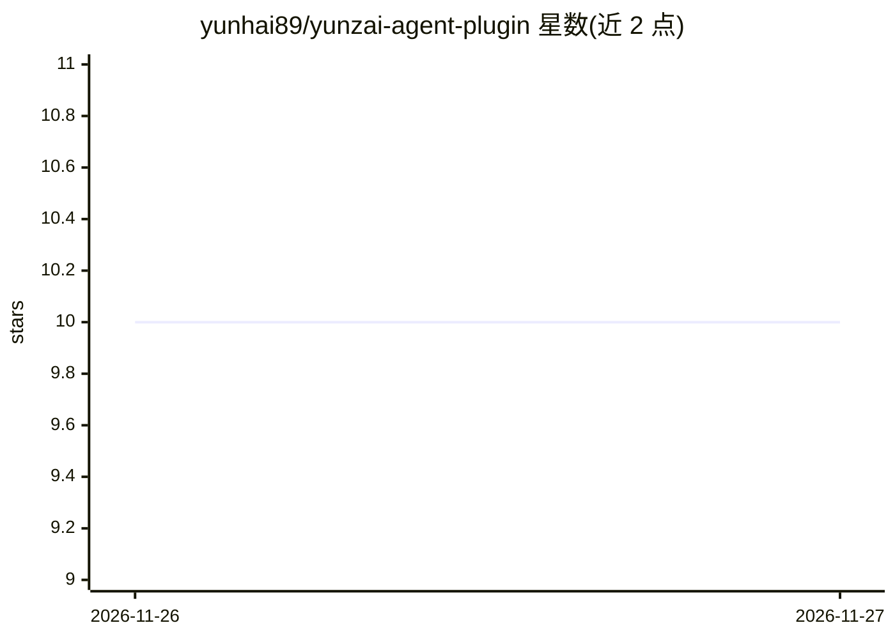

# yunhai89/yunzai-agent-plugin

⭐ 10 · JavaScript · MIT · 推送 2026-11-24 · [GitHub](https://github.com/yunhai89/yunzai-agent-plugin) · 个人维护 · 中文 README

**Yunzai 机器人的 AI Agent 插件：对话、工具调用、记忆与工具进化**

运行在 Yunzai / Miao-Yunzai 框架内的插件，将大模型对话、ReAct 多轮工具调用、长期记忆（MEMORY.md/USER.md）、人设库、MCP、E2B 沙箱与 Web 管理面板组装为一套运行时。模型接入采用 OpenAI / Anthropic / Gemini 三协议，支持厂商+模型引用制与跨厂商回退；工具具备生成→验证→审批→版本化的进化流程；配置保存即热加载，工具 RBAC 与审批机制管控权限。面向运行 QQ 群/私聊机器人或 QQ 官方机器人的用户。

## 筛选速览

| 维度 | 判定 | 备注 |
|---|---|---|
| AI 角色 | `ai-native` | 本体是模型或模型工具 |
| 许可风险 | `permissive` | MIT |
| 部署形态 | `library` | 以包/库形式分发 |
| 模型依赖 | locked-api |  |
| 硬件要求 | — | 无带数字的原话,不猜 |
| 安装摩擦 | `low` | 无编译、无系统依赖或容器化 |
| 成熟度 | `idea` | |

## 能力要点

- ReAct 多轮与并行工具调用，支持 MCP 协议
- 长期记忆召回、用户画像与知识库 RAG
- 工具进化流程：生成→验证→审批→版本化
- Web 管理面板统一配置，保存即热加载

## 适用场景

- 在 QQ 群/私聊中部署可调用工具的 AI 机器人
- 给机器人配置人设、长期记忆和知识库问答
- 接入 QQ 官方机器人（AppID + AppSecret）使用 Markdown/按钮卡片

## 场景标签

`聊天机器人` `Agent 记忆` `RAG` · 领域:Agent 开发

## 证据(README 行号)

> L3: **Yunzai / Miao-Yunzai 的模块化 AI Agent 插件** —— 不只是聊天机器人：
> L25: 一个跑在 Yunzai / Miao-Yunzai 里的 AI Agent 插件：把大模型对话、工具调用、长期记忆、人设、多模态、MCP、群管、沙箱和 Web 管理面板做成一套完整运行时。

## 星数曲线

2026-11-26 10 → 2026-11-27 10（+0）

---
*卡片 v1 · prompt 1.4 · 生成 2026-11-26 · 置信度 high · 依据 README sha `df77a20a5e23` · [字段定义](../../DATASET.md)*
