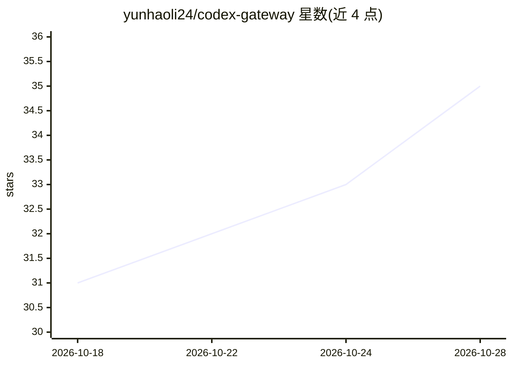

# yunhaoli24/codex-gateway

⭐ 35 · TypeScript · MIT · 推送 2026-10-27 · [GitHub](https://github.com/yunhaoli24/codex-gateway) · 个人维护 · 中文 README

**官方 Codex app-server 的自托管 Web 前端与 SSH 网关**

用 Nuxt/Vue/TypeScript 实现的自托管网关：通过 SSH 连接远程主机，管理官方 Codex app-server 守护进程（下载、验证、升级 standalone 归档并经 SFTP 上传），在浏览器中渲染会话、审批、文件变更、推理、工具与子代理活动，并保持 Codex app-server 为状态唯一来源。面向需从浏览器访问多台远程服务器上 Codex 会话的开发者，附带主机资源与 GPU 监控、跨主机 tmux 监视、远程终端与文件工作区。目前 Codex 是唯一实现的 provider。

## 筛选速览

| 维度 | 判定 | 备注 |
|---|---|---|
| AI 角色 | `ai-ecosystem` | LLM/agent 周边工具 |
| 许可风险 | `permissive` | MIT |
| 部署形态 | `self-host` | docker 或自建部署 |
| 模型依赖 | — | README 未给出锁定关系 |
| 硬件要求 | — | 无带数字的原话,不猜 |
| 安装摩擦 | `low` | 无编译、无系统依赖或容器化 |
| 成熟度 | — | 结构信号不足 |

## 能力要点

- SSH 网关管理多台远程主机上的官方 Codex app-server 生命周期
- 浏览器工作区渲染会话、Plan/Goal 模式、diff、终端与子代理面板
- 跨主机 CPU/内存/磁盘/GPU 监控与 tmux 作业监视、完成通知
- 支持 keyboard-interactive MFA 主机与断线后线程状态恢复

## 适用场景

- 在浏览器中同时使用多台远程服务器上的 Codex 会话
- 远程管理 Codex 守护进程安装与升级并跟踪训练/推理长任务
- 在对话工作区旁直接打开 SSH 终端检查远程环境

## 场景标签

`编码 Agent` · 领域:编码与开发

## 证据(README 行号)

> L15: Codex Gateway is a web frontend and connection gateway for the official Codex app-server.
> L89: The stack is Nuxt 4.6 / Vue 3 / TypeScript, with Pinia for browser state, Dockview for workspace layout, TanStack V

## 星数曲线

2026-10-18 31 → 2026-10-28 35（+4）

---
*卡片 v1 · prompt 1.4 · 生成 2026-10-25 · 置信度 mid · 依据 README sha `19b5cf97c506` · [字段定义](../../DATASET.md)*
