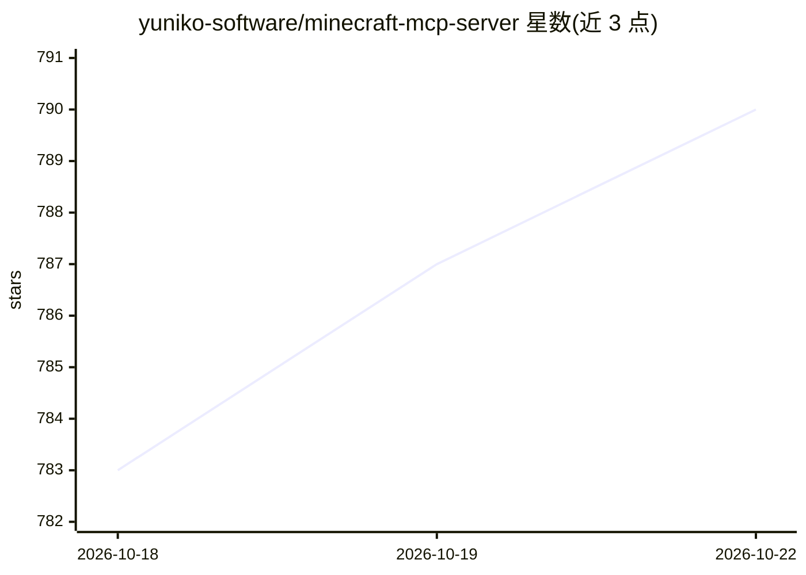

# yuniko-software/minecraft-mcp-server

⭐ 790 · TypeScript · Apache-2.0 · 推送 2026-04-04 · [GitHub](https://github.com/yuniko-software/minecraft-mcp-server) · [官网](https://yuniko.software/mcp-server/) · 组织维护

**MCP 服务器：让 Claude 等 AI 通过自然语言控制 Minecraft 角色**

基于 Mineflayer API 与 Model Context Protocol 的 Minecraft 机器人服务端：将角色移动、飞行、方块交互、物品栏管理、熔炉操作、聊天读写等约 20 个命令暴露为 MCP 工具，供 Claude Desktop 等 MCP 客户端的 AI 助手调用，实现用自然语言指挥角色建造、探索与互动。运行需 Node.js（>=20.10.0）、Git 与开启局域网世界的 Minecraft Java 版；当前支持 MC 1.21.11，更新版本可能不可用。

## 筛选速览

| 维度 | 判定 | 备注 |
|---|---|---|
| AI 角色 | `ai-ecosystem` | LLM/agent 周边工具 |
| 许可风险 | `permissive` | Apache-2.0 |
| 部署形态 | `None` |  |
| 模型依赖 | locked-api |  |
| 硬件要求 | — | 无带数字的原话,不猜 |
| 安装摩擦 | `low` | 无编译、无系统依赖或容器化 |
| 成熟度 | `idea` | |

## 能力要点

- 基于 Mineflayer API 实现实时角色控制
- 提供移动/飞行/方块/物品栏/熔炉/聊天等约 20 个 MCP 命令
- 支持上传建筑图片让 bot 照图建造
- 通过 claude_desktop_config.json 配置接入，可自定义端口与主机

## 适用场景

- 在 Claude Desktop 里用自然语言指挥 Minecraft 角色建造与探索
- 让 AI 读取游戏内聊天并代为回复
- 向 AI 展示建筑图片让其复现到游戏中

## 场景标签

 · 领域:游戏 AI/MCP 工具

## 证据(README 行号)

> L20: A Minecraft bot powered by large language models and Mineflayer API. This bot uses the Model Context Protocol (MCP)
> L35: This bot is designed to be used with Claude Desktop through the Model Context Protocol (MCP).

## 星数曲线

2026-10-18 783 → 2026-10-22 790（+7）

---
*卡片 v1 · prompt 1.4 · 生成 2026-10-21 · 置信度 high · 依据 README sha `0e6d27e679dd` · [字段定义](../../DATASET.md)*
