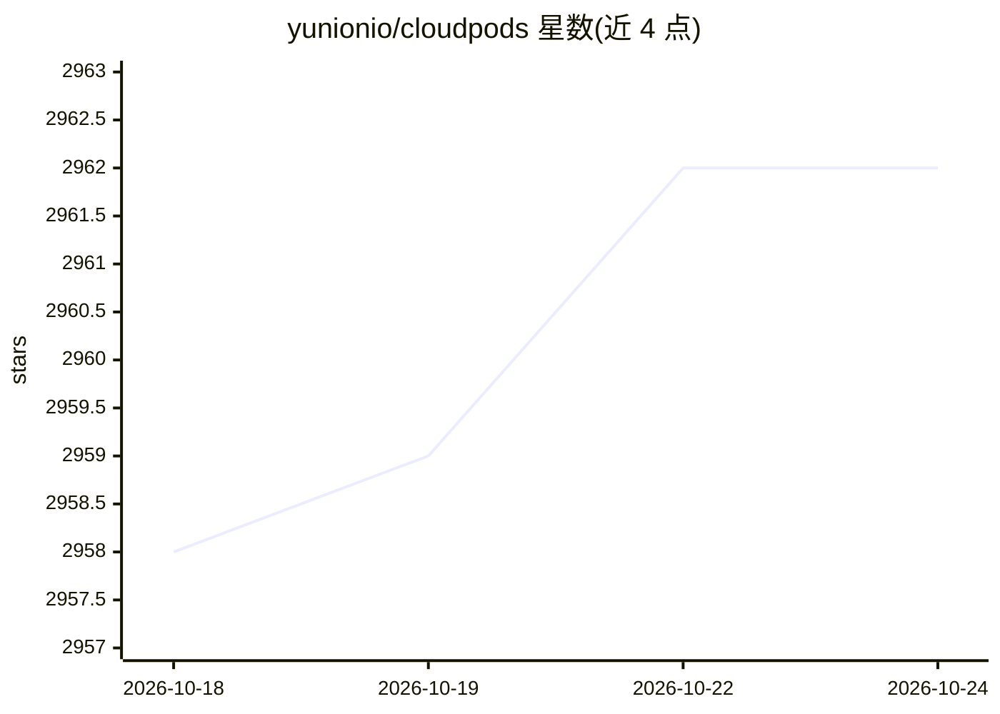

# yunionio/cloudpods

⭐ 2,962 · Go · Apache-2.0 · 推送 2026-10-22 · [GitHub](https://github.com/yunionio/cloudpods) · [官网](https://www.cloudpods.org) · 组织维护 · 中文 README

**开源云原生多云/混合云统一管理平台，含 LLM 推理调度**

以 Golang 开发的云原生多云/混合云平台（a cloud on clouds）：管理本地 KVM/裸机/VMware 等资源，并通过统一 API 接管 AWS、Azure、GCP、阿里云等 20 余家公有云与私有云账号，屏蔽底层差异。其中 AI Cloud 模块提供 LLM 推理实例（Ollama/vLLM/SGLang）的部署调度、GPU 设备检测与 NVIDIA/CUDA 环境统一管理、模型库与 AI 容器应用（Dify/ComfyUI 等）的一站式部署，面向需要统一纳管私有云、多云及 AI 工作负载的运维与企业用户。

## 筛选速览

| 维度 | 判定 | 备注 |
|---|---|---|
| AI 角色 | `ai-ecosystem` | LLM/agent 周边工具 |
| 许可风险 | `permissive` | Apache-2.0 |
| 部署形态 | `None` |  |
| 模型依赖 | local-ok | 支持本地模型 |
| 硬件要求 | — | 无带数字的原话,不猜 |
| 安装摩擦 | `medium` | 含编译或系统依赖之一 |
| 成熟度 | — | 结构信号不足 |

## 能力要点

- 统一 API 管理 20 余家公有云/私有云及本地 KVM/裸机资源
- AI Cloud：部署管理 Ollama/vLLM/SGLang 推理实例，含 GPU 调度
- GPU 设备自动检测注册与 NVIDIA/CUDA 环境统一管理
- 模型库统一管理模型来源、版本与缓存，支持离线分发

## 适用场景

- 把几台物理服务器虚拟化为私有云并纳管裸机生命周期
- 在单一门户访问多云账号资源，形成混合云统一视图
- 在私有云/多云资源上部署带 GPU 支持的 LLM 推理与 AI 容器应用

## 场景标签

 · 领域:云计算基础设施/多云管理

## 证据(README 行号)

> L12: Cloudpods is a cloud-native open source unified multi/hybrid-cloud platform developed with Golang, i.e. Cloudpods i
> L14: Cloudpods also provides **AI Cloud**, a unified management platform for large language model (LLM) inference and AI
> L32: * **AI Inference Services**: Deploy and manage LLM inference instances (Ollama, vLLM, SGLang, and more) with GPU sc

## 星数曲线

2026-10-18 2,958 → 2026-10-24 2,962（+4）

---
*卡片 v1 · prompt 1.4 · 生成 2026-10-20 · 置信度 high · 依据 README sha `0beedfaefe81` · [字段定义](../../DATASET.md)*
