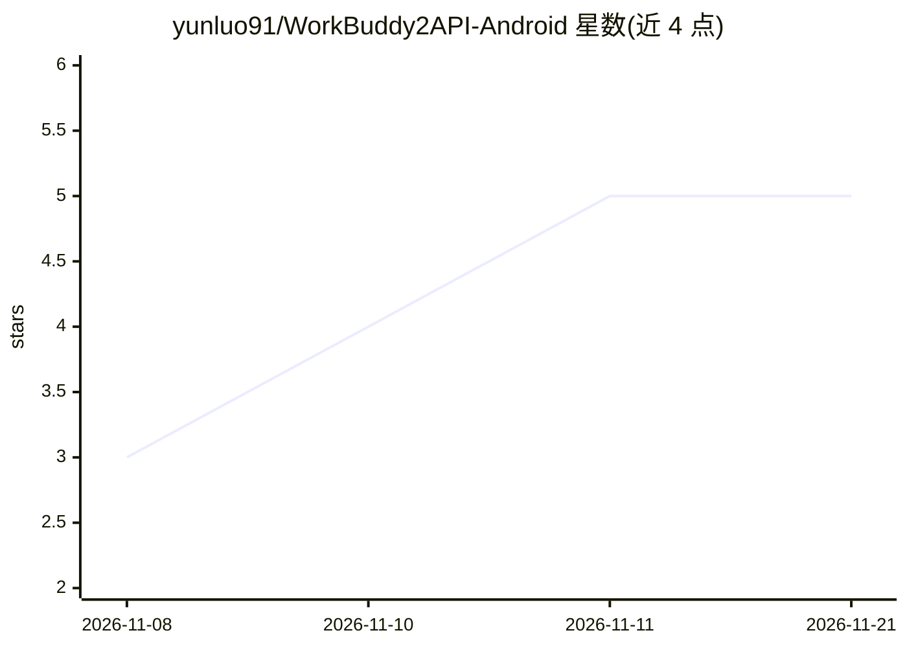

# yunluo91/WorkBuddy2API-Android

⭐ 5 · Python · MIT · 推送 2026-11-09 · [GitHub](https://github.com/yunluo91/WorkBuddy2API-Android) · 个人维护 · 中文 README

**把 WorkBuddy2API Python 网关打包成 Android APK 的外壳应用**

基于 ardeyouxipianyi/workbuddy2api-hub（MIT）的 Android 二次封装：通过 Chaquopy 内嵌 CPython 3.11 运行上游网关，装完即在手机本地提供 OpenAI 兼容服务（127.0.0.1:8888/v1）。本项目只做手机外壳、原生 Compose 界面与修补，网关逻辑来自上游。增加前台服务（specialUse + 唤醒锁 + 健康探测）做后台保活，提供对话页、调用记录、看板与控制台，支持 zip 备份/恢复。仅用于协议学习与个人自用，README 建议优先使用官方客户端。

## 筛选速览

| 维度 | 判定 | 备注 |
|---|---|---|
| AI 角色 | `ai-ecosystem` | LLM/agent 周边工具 |
| 许可风险 | `permissive` | MIT |
| 部署形态 | `None` |  |
| 模型依赖 | — | README 未给出锁定关系 |
| 硬件要求 | — | 无带数字的原话,不猜 |
| 安装摩擦 | `medium` | 含编译或系统依赖之一 |
| 成熟度 | — | 结构信号不足 |

## 能力要点

- 一个 APK 内嵌 Python 网关，本地提供 OpenAI 兼容 API，无需 root/Docker/Termux
- 前台服务 specialUse + 唤醒锁 + 每 3 秒 /health 健康探测的后台保活
- 原生 Compose 对话页支持工具调用，可读写 /sdcard 与跑 shell 命令
- 网关/调试台/控制台三端口架构，支持思考档位管理（reasoning_effort）

## 适用场景

- 在手机上本地运行 OpenAI 兼容网关供 ChatBox/NextChat/OpenAI SDK 接入
- 通过局域网开关让其他设备访问手机上的 API 服务
- 对账号池做分组管理、用量统计与备份迁移

## 场景标签

`模型网关` · 领域:Agent 开发

## 证据(README 行号)

> L25: > **这是什么** —— 把上游那个 Python 网关塞进一个 Android APK 里跑，不用电脑、不用 Docker、不用 Termux。
> L26: > 装完打开就是一个本地 OpenAI 兼容服务：`http://127.0.0.1:8888/v1`。
> L289: |8888|网关|OpenAI 兼容 API（`/v1/chat/completions`、`/v1/models`）|

## 星数曲线

2026-11-08 3 → 2026-11-21 5（+2）

---
*卡片 v1 · prompt 1.4 · 生成 2026-11-20 · 置信度 high · 依据 README sha `93f01b142be8` · [字段定义](../../DATASET.md)*
