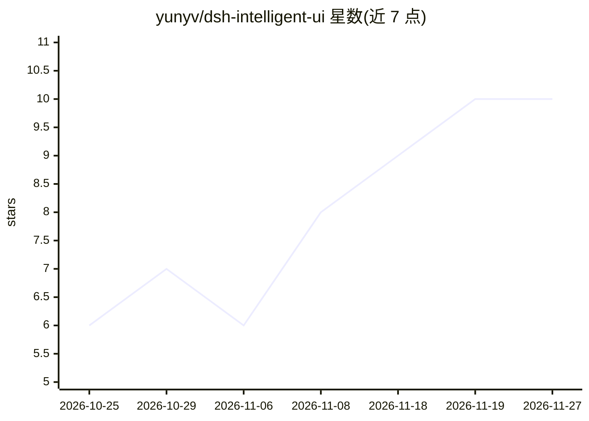

# yunyv/dsh-intelligent-ui

⭐ 10 · TypeScript · MIT · 推送 2026-10-17 · [GitHub](https://github.com/yunyv/dsh-intelligent-ui) · 个人维护

**让模型直接生成可交互界面的 DeepSeek Harness 插件**

面向 DeepSeek Harness 的插件：模型不再输出关于界面的文字描述，而是写声明式 DSL（DIL 文档），插件在无 DOM 的 Worker 沙箱中编译执行，宿主以原生 DOM 渲染出可操作的界面（滑块、开关、本地重算）。另有 engine:"html" 逃生舱路径支持自包含文档。工件按版本追加式持久化于磁盘，支持原地 patch、历史恢复与跨重启保留；流式编译使卡片在模型输出过程中即出现。以 npm 包分发，也可从仓库或 tarball 安装，要求 DSH >= 0.2.1-rc.1。

## 筛选速览

| 维度 | 判定 | 备注 |
|---|---|---|
| AI 角色 | `ai-native` | 本体是模型或模型工具 |
| 许可风险 | `permissive` | MIT |
| 部署形态 | `library` | 以包/库形式分发 |
| 模型依赖 | locked-api |  |
| 硬件要求 | — | 无带数字的原话,不猜 |
| 安装摩擦 | `low` | 无编译、无系统依赖或容器化 |
| 成熟度 | — | 结构信号不足 |

## 能力要点

- 单一 artifact 工具、两条渲染路径：DIL 编译路径与 HTML 逃生舱
- 无 DOM Worker 沙箱执行，宿主原生 DOM 渲染并适配明暗主题
- 工件版本追加式持久化，支持原地改写、restore 与乐观并发控制
- 流式编译：文档未写完时卡片已可渲染

## 适用场景

- 让模型生成可调参数的计算器、图表等可交互卡片
- 需要界面跨会话保留并可在历史版本间恢复
- 在聊天回答中嵌入无第二次模型调用的本地重算控件

## 场景标签

`代码生成` · 领域:编码与开发

## 证据(README 行号)

> L9: **Generative UI for DeepSeek Harness: the model writes an interface instead of describing one.**
> L11: An open-source take on what ChatGPT calls **Intelligent UI** (internal codename *DIL*) and Claude calls **Artifacts

## 星数曲线

2026-10-25 6 → 2026-11-27 10（+4）

---
*卡片 v1 · prompt 1.4 · 生成 2026-11-19 · 置信度 high · 依据 README sha `e7fbc735c916` · [字段定义](../../DATASET.md)*
