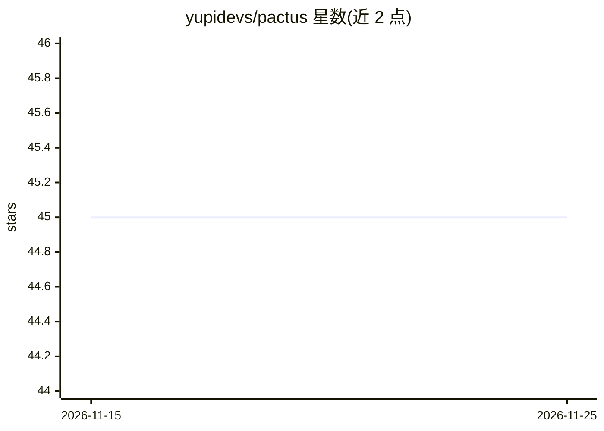

# yupidevs/pactus

⭐ 45 · Python · MIT · 推送 2026-11-15 · [GitHub](https://github.com/yupidevs/pactus) · 组织维护

**轨迹分类算法评估框架：多数据集上测试分类方法**

Python 库 pactus（Path Classification Tools for Unifying Strategies），用于在多个轨迹数据集上测试不同的分类方法。内置若干符合领域现状的模型与数据集，并以可扩展方式支持用户自建模型和数据集。内置数据集不含原始数据，首次加载时自动下载。需 Python 3.11+（最高 3.13，受 TensorFlow wheel 限制）。支持固定随机种子以保证结果可复现，输出准确率等统计。有 JOSS 论文可引用。

## 筛选速览

| 维度 | 判定 | 备注 |
|---|---|---|
| AI 角色 | `ai-native` | 本体是模型或模型工具 |
| 许可风险 | `permissive` | MIT |
| 部署形态 | `library` | 以包/库形式分发 |
| 模型依赖 | — | README 未给出锁定关系 |
| 硬件要求 | — | 无带数字的原话,不猜 |
| 安装摩擦 | `low` | 无编译、无系统依赖或容器化 |
| 成熟度 | — | 结构信号不足 |

## 能力要点

- 在多个轨迹数据集上测试不同分类方法
- 内置模型与数据集，支持用户自建扩展
- 固定随机种子保证结果可复现
- 首次加载数据集时自动下载所需数据

## 适用场景

- 在标准轨迹数据集上评估分类算法
- 对比自建模型与内置方法的表现
- 科研工作中复现轨迹分类实验并引用论文

## 场景标签

`模型评测` · 领域:评测与运维

## 证据(README 行号)

> L3: **Framework to evaluate Trajectory Classification Algorithms**
> L20: is a Python library that allows testing different classification methods on
> L21: several trajectory datasets.

## 星数曲线

2026-11-15 45 → 2026-11-25 45（+0）

---
*卡片 v1 · prompt 1.4 · 生成 2026-11-18 · 置信度 high · 依据 README sha `d10f0c53b76c` · [字段定义](../../DATASET.md)*
