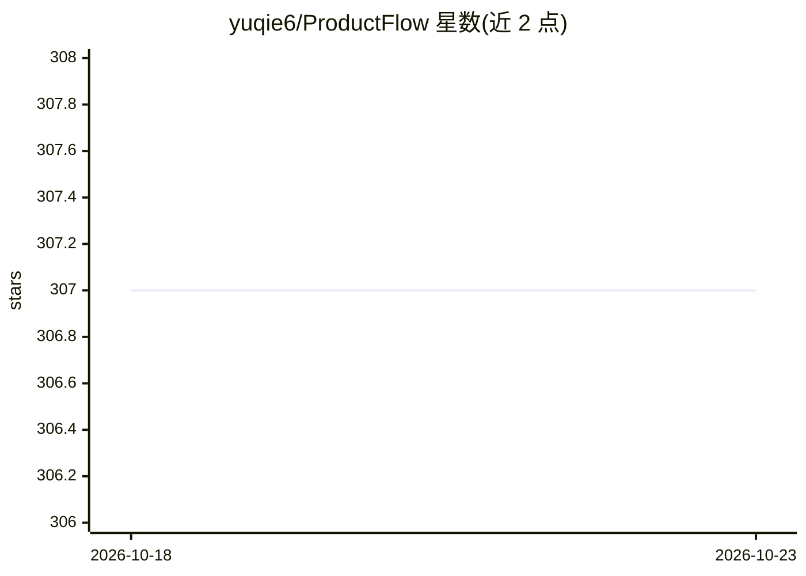

# yuqie6/ProductFlow

⭐ 307 · Python · MIT · 推送 2026-10-09 · [GitHub](https://github.com/yuqie6/ProductFlow) · [官网](https://draw.devbin.de) · 个人维护 · 中文 README

**面向小团队商家的自托管商品素材 AI 工作台**

ProductFlow 是私有单管理员实例的开源自托管应用，链路覆盖商品资料、参考图、AI 文案、AI/模板海报、连续生图会话、生成图画廊和节点画布工作流。文本供应商支持 mock 和 openai，图片供应商支持 mock、openai_responses、openai_images。部署需要 PostgreSQL、Redis、后端 API、Dramatiq worker 与 Web 前端，提供 Docker Compose 一键路径与本地开发路径；暂不提供多用户/多租户、支付、Kubernetes 等生产编排包。

## 筛选速览

| 维度 | 判定 | 备注 |
|---|---|---|
| AI 角色 | `ai-native` | 本体是模型或模型工具 |
| 许可风险 | `permissive` | MIT |
| 部署形态 | `self-host` | docker 或自建部署 |
| 模型依赖 | — | README 未给出锁定关系 |
| 硬件要求 | — | 无带数字的原话,不猜 |
| 安装摩擦 | `low` | 无编译、无系统依赖或容器化 |
| 成熟度 | — | 结构信号不足 |

## 能力要点

- 节点画布组织商品资料、参考图、文案与生图节点，移动端支持触控操作
- 文/图生图独立会话：多候选比较、分支历史、设为下一轮基图
- 供应商档案与用途绑定在 /settings 运行时配置，文本与图片能力分开配置
- Docker Compose 一键自托管，默认 mock provider 无需真实 API Key 即可跑通基础流程

## 适用场景

- 小团队商家自托管管理商品素材并生成 AI 文案与海报
- 在连续生图会话中基于参考图迭代出商品图并沉淀到画廊
- 通过可视化工作流串联商品资料、文案与生图流程

## 场景标签

 · 领域:电商/AI 内容生成

## 证据(README 行号)

> L9: ProductFlow 是面向单人或小团队商家的开源自托管商品素材工作台。核心链路覆盖商品资料、参考图、AI 文案、AI/模板海报、连续生图会话、生成图画廊和可视化工作流。
> L11: 当前形态为私有单管理员实例。自托管部署需要 PostgreSQL、Redis、后端 API、Dramatiq worker、Web 前端，以及可用的文本/图片模型供应商。
> L342: - 文案用途支持 `mock` 和 `openai`。图片用途支持 `mock`、`openai_responses`、`openai_images`。

## 星数曲线

2026-10-18 307 → 2026-10-23 307（+0）

---
*卡片 v1 · prompt 1.4 · 生成 2026-10-21 · 置信度 high · 依据 README sha `ff3e9befc6fa` · [字段定义](../../DATASET.md)*
