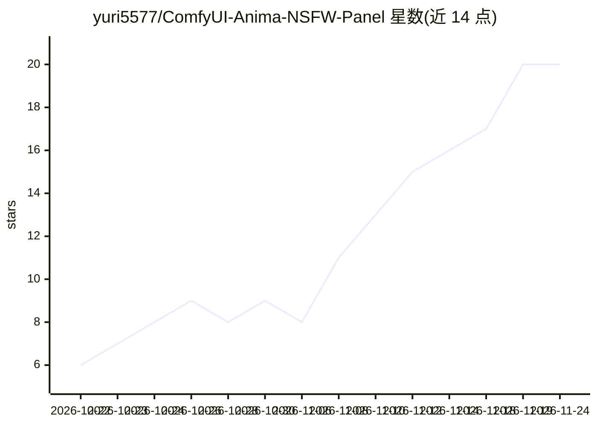

# yuri5577/ComfyUI-Anima-NSFW-Panel

⭐ 20 · Python · NOASSERTION · 推送 2026-10-14 · [GitHub](https://github.com/yuri5577/ComfyUI-Anima-NSFW-Panel) · 个人维护 · 中文 README

**Anima 模型专用的 ComfyUI 中文提示词面板与剧情工作流节点包**

面向 circlestone-labs/Anima Base（Qwen3-0.6B + T5XXL + 28 层 DiT）的 ComfyUI 节点包：提供可视化标签浮层面板（3782 个可见标签、14 分类、互斥约束、强度档位），按 Anima 的 booru 标签+自然语言语法自动合成、排序、去重提示词；含 11101 条中文标签库、8000 角色库、11 条故事线剧情模式（主角跨图固定）、SFW/NSFW 双模式（257 条露骨词拦截）、负面构建器、种子控制（写入下游 KSampler），并附带修复+4× 放大工作流与 Modulation Guidance 的 ComfyUI 实现。无额外 pip 依赖，剧情工作流需另装 ComfyUI-Impact-Pack 及模型文件。

## 筛选速览

| 维度 | 判定 | 备注 |
|---|---|---|
| AI 角色 | `ai-ecosystem` | LLM/agent 周边工具 |
| 许可风险 | `none` | NOASSERTION |
| 部署形态 | `library` | 以包/库形式分发 |
| 模型依赖 | — | README 未给出锁定关系 |
| 硬件要求 | — | 无带数字的原话,不猜 |
| 安装摩擦 | `low` | 无编译、无系统依赖或容器化 |
| 成熟度 | — | 结构信号不足 |

## 能力要点

- 3782 个可见标签全中文、14 分类、互斥约束与强度档位，按 Anima 语法自动合成提示词
- 11101 条标签库含 8000 角色 / 568 服装预设 / 297 姿势参考
- 11 条故事线 × 6 拍剧情模式，主角跨图固定、种子自动递增保证连续性
- SFW/NSFW 双模式：257 条露骨词拦截 + 服装白名单豁免机制

## 适用场景

- 在 ComfyUI 里可视化挑选中文标签合成 Anima 提示词
- 按故事线连续生成主角一致的多张图片
- 用附带工作流完成出图后的修脸、修手与 4× 放大

## 场景标签

`提示工程` `图像生成` · 领域:Agent 开发

## 证据(README 行号)

> L4: > 把「选标签 → 合成提示词 → 出图 → 修复 → 放大 → 保存」全链路做完的 ComfyUI 节点包。
> L6: 适用范围：circlestone-labs/Anima Base（Qwen3-0.6B 文本编码器 + T5XXL + 28 层 DiT）。
> L276: ## 四个节点

## 星数曲线

2026-10-22 6 → 2026-11-24 20（+14）

---
*卡片 v1 · prompt 1.4 · 生成 2026-11-18 · 置信度 mid · 依据 README sha `04f7ed29e33f` · [字段定义](../../DATASET.md)*
