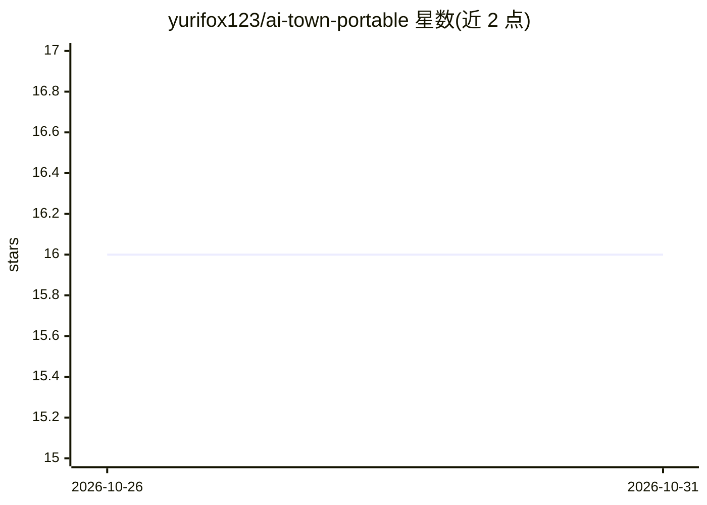

# yurifox123/ai-town-portable

⭐ 16 · JavaScript · 推送 2026-10-26 · [GitHub](https://github.com/yurifox123/ai-town-portable) · 个人维护 · 中文 README

**浏览器中运行的多智能体生存模拟小镇（生成式智能体）**

基于 Stanford《Generative Agents》论文思路的多智能体模拟项目：居民以自主 Agent 形式生活在 2D 小镇中，具备三层记忆（观察/反思/计划）、A* 寻路、生存属性（健康/饱腹/绿色积分）、污染与城镇资源演化系统，建筑可随资源升级。浏览器 Canvas 实时渲染，Node.js + TypeScript 后端负责静态资源、SQLite 持久化与 LLM 代理；LLM 走 custom 兼容接口（默认 DashScope Anthropic 兼容端点、Kimi K2.5 模型），需用户自填 API Key。支持快照存档、地图编辑与 REST API，面向 Agent 演示、研究原型与教学场景。

## 筛选速览

| 维度 | 判定 | 备注 |
|---|---|---|
| AI 角色 | `ai-native` | 本体是模型或模型工具 |
| 许可风险 | `none` | — |
| 部署形态 | `None` |  |
| 模型依赖 | — | README 未给出锁定关系 |
| 硬件要求 | — | 无带数字的原话,不猜 |
| 安装摩擦 | `low` | 无编译、无系统依赖或容器化 |
| 成熟度 | — | 结构信号不足 |

## 能力要点

- 三层记忆系统（观察/反思/计划）驱动 Agent 决策，记忆检索采用三维加权评分
- 生存与经济系统：健康、饱腹、绿色积分、污染与城镇全局资源共同演化
- 浏览器 Canvas 实时渲染 + Node.js 后端 SQLite 持久化与快照存档
- custom 兼容接口的 LLM 代理配置，浏览器内可测试保存

## 适用场景

- 把智能体放进可观察的 2D 世界做产品演示
- 验证记忆检索、规划链路与角色设定的多智能体研究原型
- 互动式展览或教学中展示生成式智能体的协作与失衡

## 场景标签

`多智能体` · 领域:Agent 开发

## 证据(README 行号)

> L3: AI 生存小镇是一个基于 Stanford《Generative Agents》论文思路实现的多智能体模拟项目。居民以自主 Agent 的形式生活在一个 2D 小镇中，拥有记忆、反思、规划、移动、对话和生存需求；整个模拟过程在浏览器
> L7: AI 生存小镇不是一个单纯的“聊天机器人集合”，而是一个可运行、可观察、可扩展的多智能体社会实验场。项目将记忆系统、反思机制、行为规划、生存压力、资源循环和环境污染统一到同一个 2D 世界里，让每个 Agent 都不只是回答问题，而
> L11: 从展示效果上看，它兼具“可玩性”和“可讲述性”：浏览器中可以实时看到居民移动、对话、工作、饥饿、休息和环境变化；从研究和产品视角看，它又提供了一个非常适合验证 Agent 行为、提示词设计、长期记忆机制和社会型模拟交互的实验底座。

## 星数曲线

2026-10-26 16 → 2026-10-31 16（+0）

---
*卡片 v1 · prompt 1.4 · 生成 2026-10-30 · 置信度 high · 依据 README sha `f6c695c157c2` · [字段定义](../../DATASET.md)*
