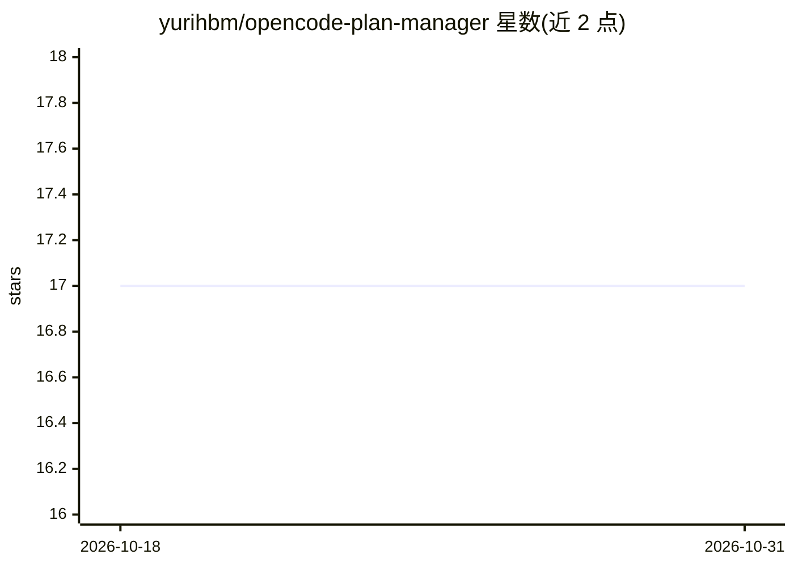

# yurihbm/opencode-plan-manager

⭐ 17 · TypeScript · MIT · 推送 2026-06-07 · [GitHub](https://github.com/yurihbm/opencode-plan-manager) · [官网](https://www.npmjs.com/package/opencode-plan-manager) · 个人维护

**OpenCode 插件：给 AI agent 提供结构化的计划管理与追踪工具**

面向 OpenCode 平台的 TypeScript 插件，为 agentic coding 工作流提供计划创建、读取与更新工具（plan_create/plan_list/plan_read/plan_update）。计划以纯文件形式存于 .opencode/plans/ 下的 pending/in_progress/done 文件夹，状态通过原子文件夹移动切换，无数据库。计划结构经 Zod 校验，plan_read 支持按 summary/spec/plan/full 视图选择性加载上下文。设计上配合 Planner → Builder 双 agent 模式，附示例计划文件夹。以 OpenCode 配置项方式安装，开发用 Bun。

## 筛选速览

| 维度 | 判定 | 备注 |
|---|---|---|
| AI 角色 | `ai-ecosystem` | LLM/agent 周边工具 |
| 许可风险 | `permissive` | MIT |
| 部署形态 | `self-host` | docker 或自建部署 |
| 模型依赖 | — | README 未给出锁定关系 |
| 硬件要求 | — | 无带数字的原话,不猜 |
| 安装摩擦 | `low` | 无编译、无系统依赖或容器化 |
| 成熟度 | — | 结构信号不足 |

## 能力要点

- plan_create/plan_list/plan_read/plan_update 四个计划管理工具，Zod 严格校验
- 文件系统看板：pending/in_progress/done 文件夹原子切换，无隐藏数据库
- plan_read 按 summary/spec/plan/full 视图选择性加载上下文
- 计划为普通文件提交到仓库，支持跨会话、跨机器、跨 agent 续接

## 适用场景

- agentic coding 中让 Plan Agent 制定规格、Build Agent 按计划执行
- 长周期或跨会话功能开发中保持任务进度不丢失
- 通过文件系统看板追踪 AI agent 的任务状态

## 场景标签

`Agent 记忆` · 领域:Agent 开发

## 证据(README 行号)

> L3: OpenCode Plugin
> L10: Stop losing context mid-feature or with cross-session work. OpenCode Plan Manager gives your AI agents a structured

## 星数曲线

2026-10-18 17 → 2026-10-31 17（+0）

---
*卡片 v1 · prompt 1.4 · 生成 2026-10-29 · 置信度 mid · 依据 README sha `c88134a2bdd0` · [字段定义](../../DATASET.md)*
