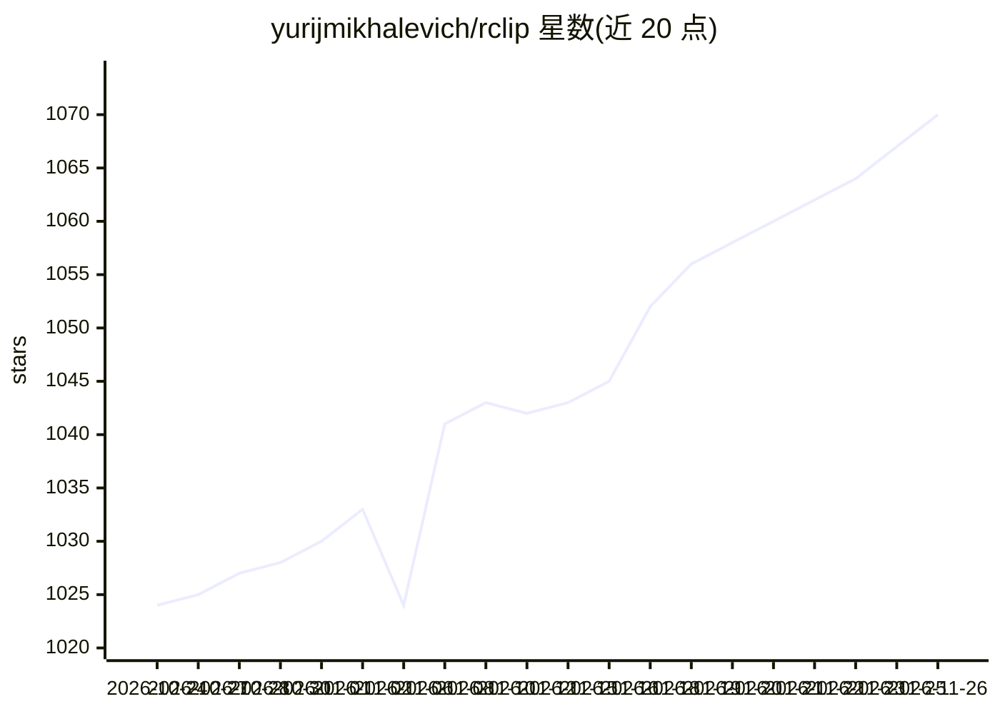

# yurijmikhalevich/rclip

⭐ 1,070 · Python · MIT · 推送 2026-11-24 · [GitHub](https://github.com/yurijmikhalevich/rclip) · 个人维护

**终端本地离线图片语义搜索工具：自然语言或示例图找照片**

命令行图片搜索工具，在本地对指定目录及其子目录建索引，支持自然语言文本查询、以图搜图及多查询加减与权重组合，输出相似度评分排序的文件路径。模型在本地运行，索引不离开本机，可经 SSH 在无头服务器使用，支持管道接 xargs/feh、`--json` 供脚本与 AI agent 调用，另有交互式终端 UI（需 Kitty 图形支持）。首次运行需建索引，耗时随图片数量与 CPU 而定。通过 snap/AppImage/brew/MSI/pip 分发。

## 筛选速览

| 维度 | 判定 | 备注 |
|---|---|---|
| AI 角色 | `ai-native` | 本体是模型或模型工具 |
| 许可风险 | `permissive` | MIT |
| 部署形态 | `desktop` | 安装包/桌面程序 |
| 模型依赖 | — | README 未给出锁定关系 |
| 硬件要求 | — | 无带数字的原话,不猜 |
| 安装摩擦 | `low` | 无编译、无系统依赖或容器化 |
| 成熟度 | — | 结构信号不足 |

## 能力要点

- 本地离线运行，基于 OpenCLIP ViT-B/32 嵌入文本与图像
- 文本与图像查询可加减组合并加权（如 `./beach.jpg` + sunset - people）
- `--json` 输出供脚本与 AI agents 调用，可经 SSH 使用
- 交互式终端 UI 支持网格/详情浏览与复制下载

## 适用场景

- 不导入相册库，直接在本地文件夹按内容语义搜图
- 在外部硬盘或 NAS 上离线检索照片
- 用脚本或 AI agent 通过 --json 批量取图片搜索结果

## 场景标签

`语义搜索` · 领域:知识与检索

## 证据(README 行号)

> L5: Search any folder by what its images contain. Use natural language, an example image, or both – without tagging, upl
> L243: **rclip** currently uses OpenCLIP's ViT-B/32 model, based on OpenAI's CLIP architecture, to embed images and text 

## 星数曲线

2026-10-24 1,024 → 2026-11-26 1,070（+46）

---
*卡片 v1 · prompt 1.4 · 生成 2026-11-24 · 置信度 high · 依据 README sha `d272db223a07` · [字段定义](../../DATASET.md)*
