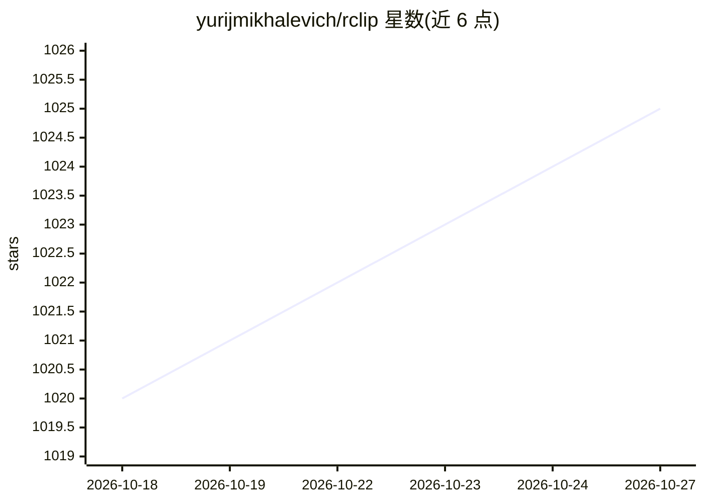

# yurijmikhalevich/rclip

⭐ 1,025 · Python · MIT · 推送 2026-10-21 · [GitHub](https://github.com/yurijmikhalevich/rclip) · 个人维护

**终端本地图片语义搜索工具：用自然语言或示例图查图**

本地离线的命令行图片搜索工具：对目录内图片建立索引并生成嵌入，支持自然语言查询、以图搜图（本地路径或 URL）以及文本与图片的加权组合与相减查询。首次运行时抽取特征建索引，后续增量更新；提供交互式终端缩略图 UI（需 Kitty graphics）、终端内预览、--filepath-only 输出以便管道搭配其他 Unix 工具。使用 OpenCLIP 的 ViT-B/32 模型（基于 OpenAI CLIP 架构）在本地机器上生成嵌入。支持 Linux/macOS(Apple Silicon)/Windows；HEIC 在 Linux 上不可用，RAW 格式为实验性支持。

## 筛选速览

| 维度 | 判定 | 备注 |
|---|---|---|
| AI 角色 | `ai-native` | 本体是模型或模型工具 |
| 许可风险 | `permissive` | MIT |
| 部署形态 | `desktop` | 安装包/桌面程序 |
| 模型依赖 | — | README 未给出锁定关系 |
| 硬件要求 | — | 无带数字的原话,不猜 |
| 安装摩擦 | `low` | 无编译、无系统依赖或容器化 |
| 成熟度 | — | 结构信号不足 |

## 能力要点

- 自然语言、以图搜图及文本图片组合加权/相减查询
- 完全本地离线运行，图片不离开本机
- OpenCLIP ViT-B/32 模型生成图文嵌入（CLIP 架构）
- 增量索引：仅处理新增或变更的图片；交互式终端 UI 与 Kitty graphics 预览

## 适用场景

- 在不导入照片库的前提下，用一句话搜索本地文件夹里的图片
- 上传或整理照片时用示例图找相似图片并批量复制
- 在 SSH 远程机器（如 NAS）上对海量照片做终端搜索，输出文件路径管道到其他工具

## 场景标签

`语义搜索` · 领域:知识与检索

## 证据(README 行号)

> L9: Search any folder by what its images contain. Use natural language, an example image, or both – without tagging, upl
> L230: **rclip** currently uses the OpenCLIP's ViT-B/32 AI model to generate embeddings for images and text. This enables

## 星数曲线

2026-10-18 1,020 → 2026-10-27 1,025（+5）

---
*卡片 v1 · prompt 1.4 · 生成 2026-10-21 · 置信度 high · 依据 README sha `58c0d2f6acb8` · [字段定义](../../DATASET.md)*
