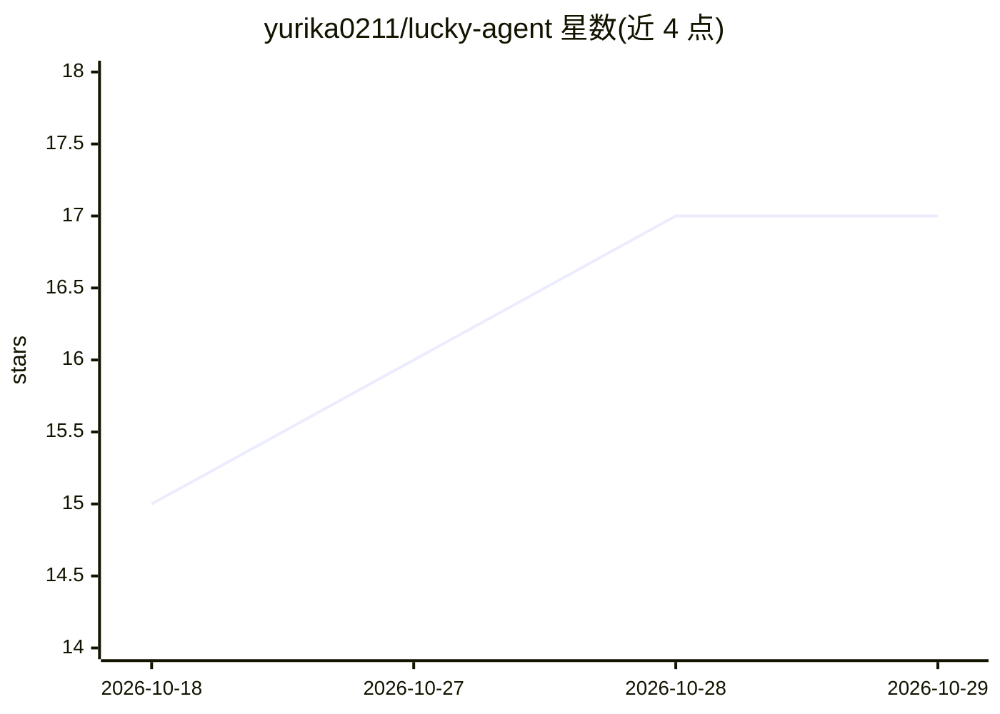

# yurika0211/lucky-agent

⭐ 17 · Go · MIT · 推送 2026-10-28 · [GitHub](https://github.com/yurika0211/lucky-agent) · [官网](https://yurika0211.github.io/lucky-agent/) · 个人维护 · 中文 README

**Go 实现的 Agent 框架：长任务规划、长期记忆与多渠道运行时**

LuckyAgent 是一套 Go 编写的 Agent 基础设施：CLI、HTTP API 和消息网关共享同一 Agent 核心，模块拆分为 agent 核心、luckyagent-app（CLI/API/SDK/评测）与 runtime。提供会话存储与生命周期保护、基于 Obsidian 兼容 Markdown vault 的长期记忆、RAG 知识库（含 Graph RAG）、工具/技能/MCP/OpenCLI 支持、插件 marketplace、多 Agent 协作与委派，以及长任务上下文管理（有界历史投影、执行账本）。凭据独立存储并通过临时工具按需注入，明文不进入模型上下文。面向需要嵌入或自部署 Agent 的开发者，以 Go 库 SDK、源码、Docker Compose 与发布包形式提供。

## 筛选速览

| 维度 | 判定 | 备注 |
|---|---|---|
| AI 角色 | `ai-ecosystem` | LLM/agent 周边工具 |
| 许可风险 | `permissive` | MIT |
| 部署形态 | `self-host` | docker 或自建部署 |
| 模型依赖 | — | README 未给出锁定关系 |
| 硬件要求 | — | 无带数字的原话,不猜 |
| 安装摩擦 | `low` | 无编译、无系统依赖或容器化 |
| 成熟度 | — | 结构信号不足 |

## 能力要点

- CLI、HTTP API 与消息网关共享统一 Agent 运行时
- Obsidian 兼容 Markdown vault 长期记忆与 RAG/Graph RAG 检索
- 支持 Telegram、QQ、飞书、微信、NapCat 等消息网关入口
- 凭据独立存储，经 TTL 临时工具按会话注入，明文不进模型上下文
- 进程内 Embed SDK，可作为 Go library 嵌入宿主程序

## 适用场景

- 自部署一个带长期记忆和知识库检索的个人 Agent
- 通过 Telegram/QQ/微信等消息渠道运行机器人
- 以 Go SDK 形式把 Agent 能力嵌入自己的应用
- 构建需要多 Agent 协作与委派的长任务工作流

## 场景标签

 · 领域:LLM Agent 基础设施

## 证据(README 行号)

> L5: LuckyAgent 主仓库维护公开的 Agent 核心库，并保留构建完整 `lh` 程序的薄入口。模型、会话、记忆、RAG 和应用入口来自独立 Go 模块，在同一个进程内组装运行。
> L7: 它不是只提供一个聊天窗口，而是提供一套可以观察、配置和持续运行的 Agent 基础设施。
> L50: - **统一运行时**：CLI、HTTP API 和消息网关共享同一个 Agent 核心。

## 星数曲线

2026-10-18 15 → 2026-10-29 17（+2）

---
*卡片 v1 · prompt 1.4 · 生成 2026-10-29 · 置信度 high · 依据 README sha `1ac6ecfc7bc2` · [字段定义](../../DATASET.md)*
