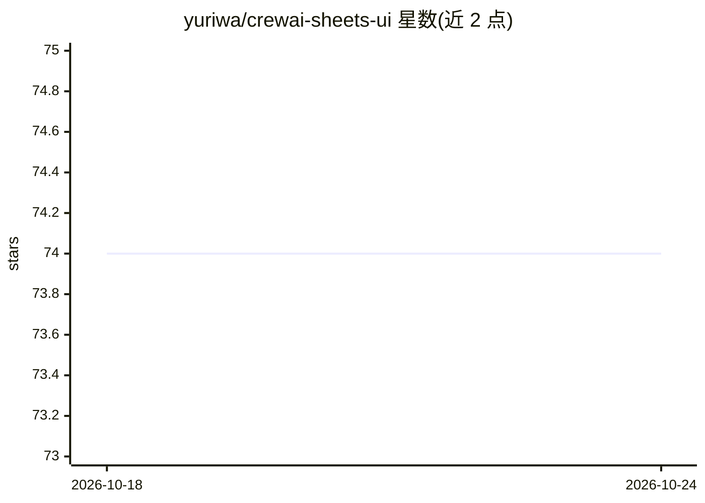

# yuriwa/crewai-sheets-ui

⭐ 74 · Python · MIT · 推送 2026-01-08 · [GitHub](https://github.com/yuriwa/crewai-sheets-ui) · 个人维护

**用 Google Sheets 作为 CrewAI 多智能体界面，无代码编排 AI 任务**

个人维护的业余项目（已宣布关闭并由 EpicStaff 接替）：把 Google Sheets 用作 crewAI 的图形界面，面向不熟悉编程的用户编排 GPT 智能体、管理项目、切换模型。工具库覆盖 crewai-tools 与 langchain 系列，含基于 open-interpreter 的执行器工具；兼容 OpenAI、Azure、Anthropic、Groq、Hugging Face 等提供商，也支持 Ollama 本地模型，并提供 Docker 与源码两种运行方式。

## 筛选速览

| 维度 | 判定 | 备注 |
|---|---|---|
| AI 角色 | `ai-ecosystem` | LLM/agent 周边工具 |
| 许可风险 | `permissive` | MIT |
| 部署形态 | `self-host` | docker 或自建部署 |
| 模型依赖 | local-ok | 支持本地模型 |
| 硬件要求 | — | 无带数字的原话,不猜 |
| 安装摩擦 | `low` | 无编译、无系统依赖或容器化 |
| 成熟度 | `idea` | |

## 能力要点

- Google Sheets 作为 UI 编排 CrewAI 智能体与项目
- 兼容 OpenAI/Azure/Anthropic/Groq/Hugging Face 提供商，可一键切换模型
- 支持 Ollama 本地模型与 Groq 限流处理
- 基于 open-interpreter 的执行器工具，可运行命令生成代码

## 适用场景

- 不写代码、通过表格界面让 AI 智能体帮我完成日常任务
- 为不同智能体和任务分别配置不同 LLM 模型
- 本地跑 Ollama 模型离线执行智能体任务

## 场景标签

 · 领域:LLM 应用/智能体编排

## 证据(README 行号)

> L25: - **Extensive Tools Library**: From `crewai-sheets-ui` to `crewai-tools`, including the latest from `langchain` and
> L41: - **Familiar Interface**: Leveraging a Google Sheets UI, this tool brings advanced automation into an easy-to-use, 

## 星数曲线

2026-10-18 74 → 2026-10-24 74（+0）

---
*卡片 v1 · prompt 1.4 · 生成 2026-10-24 · 置信度 mid · 依据 README sha `9e15b6cc5db4` · [字段定义](../../DATASET.md)*
