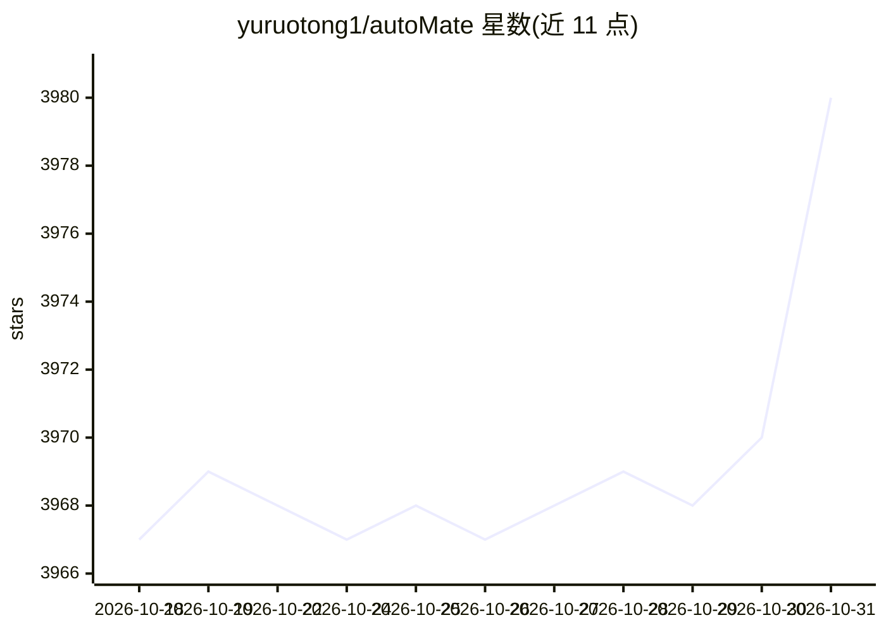

# yuruotong1/autoMate

⭐ 3,980 · Python · MIT · 推送 2026-09-18 · [GitHub](https://github.com/yuruotong1/autoMate) · 个人维护 · 中文 README

**本地个人数据中枢：为各类 AI 客户端提供笔记/文件/记忆/工具的 MCP 工具源**

自托管的个人基础设施服务：以 MCP-over-HTTP 与 REST/WS 接口向 OpenClaw、Claude Desktop、Cursor、Cline 等 AI 客户端暴露 40+ 工具，覆盖 markdown 笔记、去重文件库（SQLite FTS5 混合检索）、长期记忆、提醒推送、语音转写，以及 shell/脚本/桌面/浏览器执行器和 31 个 SaaS 集成；也可通过自带 web chat 与 agent loop 独立使用。LLM 目录含 25 家供应商。服务器默认绑定 127.0.0.1，密钥 Fernet 加密，autoMate Cloud 付费层为可选加入。提供 pip 包、独立二进制、Docker、浏览器扩展与 PWA。

## 筛选速览

| 维度 | 判定 | 备注 |
|---|---|---|
| AI 角色 | `ai-ecosystem` | LLM/agent 周边工具 |
| 许可风险 | `permissive` | MIT |
| 部署形态 | `self-host` | docker 或自建部署 |
| 模型依赖 | local-ok | 支持本地模型 |
| 硬件要求 | — | 无带数字的原话,不猜 |
| 安装摩擦 | `low` | 无编译、无系统依赖或容器化 |
| 成熟度 | — | 结构信号不足 |

## 能力要点

- 以 MCP/HTTP 向任意 AI 客户端暴露 40+ 工具，另含自带 web chat 与 agent loop
- 笔记/文件/记忆/提醒的个人数据层，文件库内容寻址去重、存储路径可指向外接 SSD 或 NAS
- 本地执行器（shell/Python/Bash/Node/pyautogui/Playwright）与 31 个 SaaS 平台集成
- LLM 目录支持 25 家供应商，含 Ollama/LM Studio 与任意 OpenAI 兼容端点

## 适用场景

- 让常用的 AI 聊天客户端共享同一份跨会话的笔记、文件与记忆
- 在 NAS 或无头主机上部署 Docker 版作为个人数据仓库
- 通过微信/Telegram 等 IM 渠道操作本地文件与工具（配合 OpenClaw）

## 场景标签

`Agent 记忆` `知识库管理` `浏览器自动化` `语音识别` · 领域:Agent 开发

## 证据(README 行号)

> L20: autoMate is the layer behind the chat: a warehouse you own. Pick a
> L52: After the client picks up the new server, it gets all autoMate's
> L99: **LLM providers** — 25 in the catalog: OpenAI · Anthropic · Gemini · xAI Grok ·

## 星数曲线

2026-10-18 3,967 → 2026-10-31 3,980（+13）

---
*卡片 v1 · prompt 1.4 · 生成 2026-10-20 · 置信度 high · 依据 README sha `4e9655b31067` · [字段定义](../../DATASET.md)*
