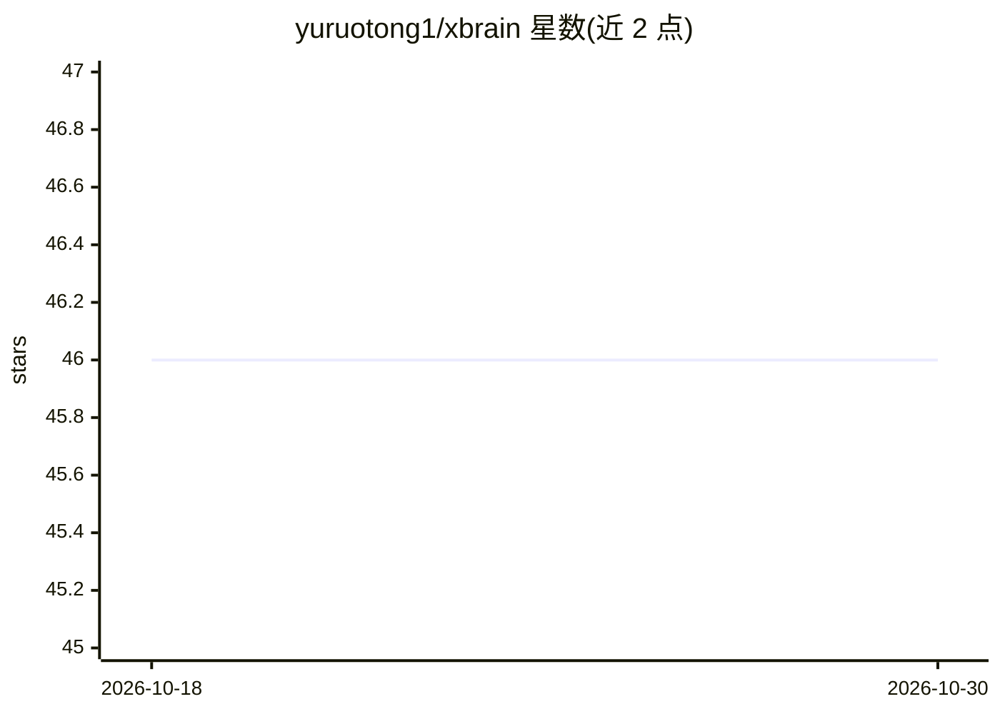

# yuruotong1/xbrain

⭐ 46 · Python · 推送 2025-12-05 · [GitHub](https://github.com/yuruotong1/xbrain) · 个人维护 · 中文 README

**极简智能体开发框架：装饰器接入 Function Call**

面向开发者的 Python 智能体开发框架：通过装饰器将普通函数注册为 OpenAI Chat 的 Function Call 工具，并用 Pydantic 模型自动生成工具描述；提供 Agent/WorkFlow 类按顺序编排智能体节点，支持智能体间全局上下文共享、参数传递与逐节点结果返回。另支持传入 Pydantic 模型作为 response_format 获得结构化强类型响应，配置保存在 ~/.xbrain/config.yaml。环境要求 Python ≥ 3.8 与有效的 OpenAI API Key。

## 筛选速览

| 维度 | 判定 | 备注 |
|---|---|---|
| AI 角色 | `ai-ecosystem` | LLM/agent 周边工具 |
| 许可风险 | `none` | — |
| 部署形态 | `library` | 以包/库形式分发 |
| 模型依赖 | — | README 未给出锁定关系 |
| 硬件要求 | — | 无带数字的原话,不猜 |
| 安装摩擦 | `low` | 无编译、无系统依赖或容器化 |
| 成熟度 | — | 结构信号不足 |

## 能力要点

- 装饰器一键接入 Function Call，Pydantic 自动生成工具描述
- Agent/WorkFlow 管线按序编排执行，支持多种创建方式
- 智能体间全局上下文共享，run 返回每个 Agent 的执行结果
- response_format（Pydantic）结构化强类型返回

## 适用场景

- 快速把现有 Python 函数封装为 LLM 工具
- 按顺序编排多个智能体节点构建工作流
- 让模型严格返回指定 Pydantic 结构的数据

## 场景标签

`Agent 框架` · 领域:Agent 开发

## 证据(README 行号)

> L6: 极简的智能体开发框架。
> L10: - 装饰器一键接入 Function Call（Pydantic 模型自动生成工具描述）

## 星数曲线

2026-10-18 46 → 2026-10-30 46（+0）

---
*卡片 v1 · prompt 1.4 · 生成 2026-10-25 · 置信度 high · 依据 README sha `f21375c3dc73` · [字段定义](../../DATASET.md)*
