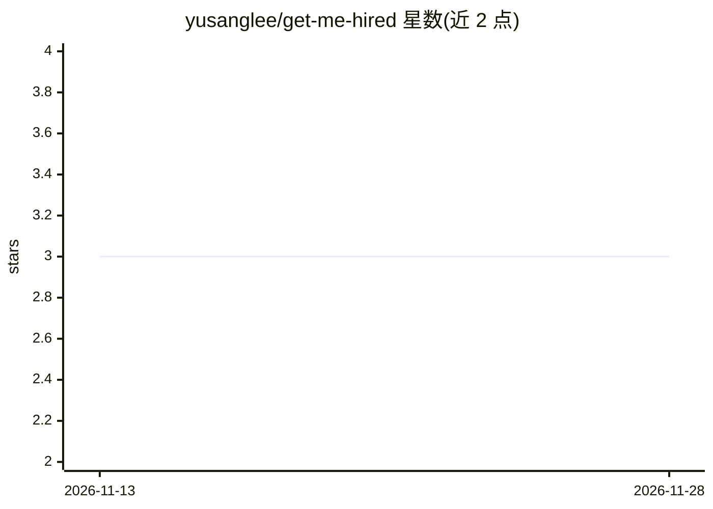

# yusanglee/get-me-hired

⭐ 3 · Python · MIT · 推送 2026-11-17 · [GitHub](https://github.com/yusanglee/get-me-hired) · 个人维护

**求职者的 AI 求职助手：找职位、定制简历、填表到提交前**

运行在 Claude Code 内的求职助手插件：每日搜索目标公司职位板并按用户背景打分分级，从用户已批准的要点生成定制简历与求职信（草稿+复审双 agent），在本地浏览器自动填写 Greenhouse/Lever/Ashby 表单并在 Submit 前停止。所有提交均需用户逐条确认。依赖 Claude 付费计划，引擎 gmh 仅用 Python 标准库，仅实测 macOS。

## 筛选速览

| 维度 | 判定 | 备注 |
|---|---|---|
| AI 角色 | `ai-native` | 本体是模型或模型工具 |
| 许可风险 | `permissive` | MIT |
| 部署形态 | `library` | 以包/库形式分发 |
| 模型依赖 | locked-api |  |
| 硬件要求 | — | 无带数字的原话,不猜 |
| 安装摩擦 | `low` | 无编译、无系统依赖或容器化 |
| 成熟度 | — | 结构信号不足 |

## 能力要点

- 人审循环：每份申请经用户点名确认才提交
- Setup 从用户全部简历版本构建 profile，不编造事实
- 多 agent 流水线：职位评分、简历选择、草稿起草与复审
- 支持 Gmail 同步、tracker.csv 追踪与面试准备包

## 适用场景

- 每天批量筛选新职位并按分级决定投递
- 为每个职位自动生成定制简历和求职信
- 自动填写招聘网站申请表，人工点提交
- 投递后跟进邮件与面试准备

## 场景标签

`浏览器自动化` · 领域:效率与自动化

## 证据(README 行号)

> L7: get-me-hired is a job-search assistant that runs inside an AI coding tool, built first for Claude Code. Each day it
> L9: builds a tailored resume from bullets you've already approved, drafts cover letters and answers, and fills the
> L62: |An AI coding tool|Claude Code is recommended and the only one tested. Codex CLI, Gemini CLI and Antigravity CLI ar

## 星数曲线

2026-11-13 3 → 2026-11-28 3（+0）

---
*卡片 v1 · prompt 1.4 · 生成 2026-11-21 · 置信度 mid · 依据 README sha `47d0372a96b9` · [字段定义](../../DATASET.md)*
