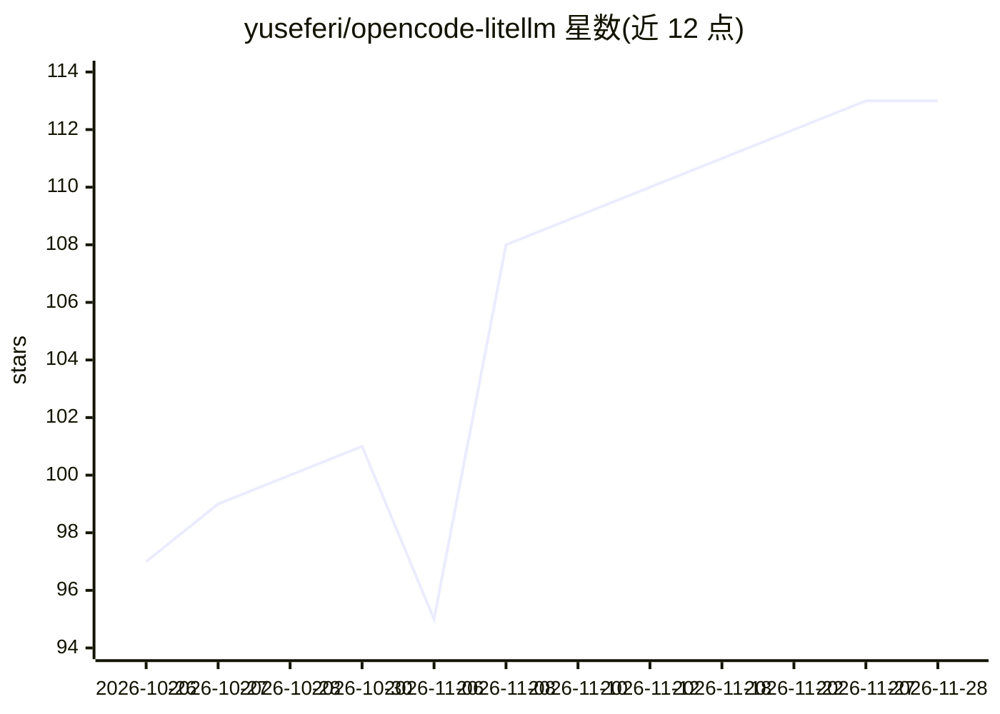

# yuseferi/opencode-litellm

⭐ 113 · TypeScript · MIT · 推送 2026-11-18 · [GitHub](https://github.com/yuseferi/opencode-litellm) · [官网](https://www.npmjs.com/package/opencode-plugin-litellm) · 个人维护

**OpenCode 插件：自动发现 LiteLLM 代理的模型并注册**

面向 OpenCode CLI v1/v2 与 Desktop 用户的 LiteLLM 提供方插件：启动时探测本地常见端口上的 LiteLLM 代理，查询 /v1/models 与 /v1/model/info，把发现的模型动态注册进 OpenCode 的 provider 注册表，免去在 opencode.json 中手工维护模型列表。机制包括磁盘缓存与 stale-while-revalidate 刷新、模型名格式化、模态过滤、成本映射、推理档位变体、Responses API 路由、SSO 登录与 include/exclude 模型目录拆分。V2 支持尚未发布到 npm 包。

## 筛选速览

| 维度 | 判定 | 备注 |
|---|---|---|
| AI 角色 | `ai-ecosystem` | LLM/agent 周边工具 |
| 许可风险 | `permissive` | MIT |
| 部署形态 | `library` | 以包/库形式分发 |
| 模型依赖 | local-ok | 支持本地模型 |
| 硬件要求 | — | 无带数字的原话,不猜 |
| 安装摩擦 | `low` | 无编译、无系统依赖或容器化 |
| 成熟度 | — | 结构信号不足 |

## 能力要点

- 自动探测 localhost:4000/:8000/:8080 上的 LiteLLM 代理并拉取 /v1/models
- 磁盘缓存 + 后台刷新（条目 7 天过期），新模型无需重启
- 映射真实计费成本、隐藏 embedding/图像/音频模型、按能力标志声明 temperature
- includeModels/excludeModels 通配符可把一个代理拆成多个 OpenCode 提供方

## 适用场景

- 用 LiteLLM 统一代理多个上游模型并在 OpenCode 中直接选用
- 代理的 model_list 更新后不在 OpenCode 配置里手工同步模型
- 团队通过网关/SSO 凭据接入模型并查看真实调用成本

## 场景标签

`模型网关` · 领域:Agent 开发

## 证据(README 行号)

> L18: Auto-detect a running LiteLLM proxy, pull every model from `/v1/models`, and register them in OpenCode.
> L37: `opencode-litellm` removes that loop entirely. It queries your LiteLLM proxy during plugin setup and registers disc
> L82: |🔌 **OpenCode V1 + V2**|Supports OpenCode 2's native `Plugin.define`, provider transforms, event subscription, and 

## 星数曲线

2026-10-26 97 → 2026-11-28 113（+16）

---
*卡片 v1 · prompt 1.4 · 生成 2026-11-28 · 置信度 mid · 依据 README sha `5c255fe6a125` · [字段定义](../../DATASET.md)*
