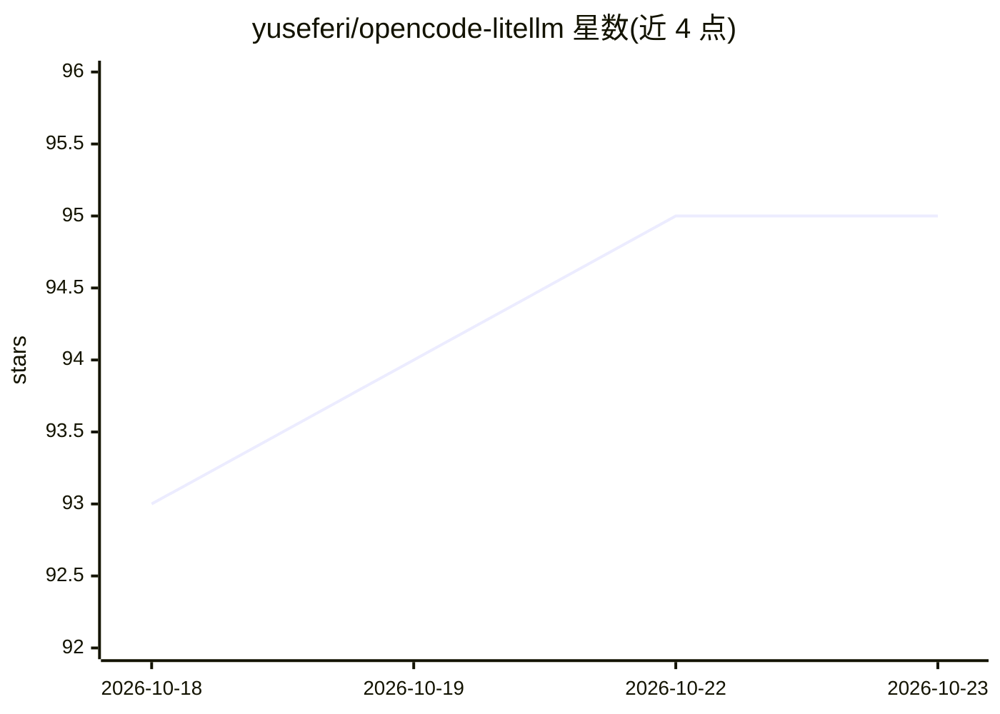

# yuseferi/opencode-litellm

⭐ 95 · TypeScript · MIT · 推送 2026-10-20 · [GitHub](https://github.com/yuseferi/opencode-litellm) · [官网](https://www.npmjs.com/package/opencode-plugin-litellm) · 个人维护

**让 OpenCode CLI/Desktop 自动发现 LiteLLM 代理模型的插件**

面向使用 OpenCode（V1 与 V2 CLI 及 Desktop）开发者的 TypeScript 插件：自动探测运行中的 LiteLLM 代理（localhost:4000/8000/8080），拉取 /v1/models 并把发现的模型注册进 OpenCode 的 provider registry，免去手工维护 models 配置。附带模型名美化、价格映射、模态过滤、reasoning-effort 变体与 Responses API 路由等功能。V2 路径尚未随已发布的 npm 包提供（README 注明当前 plugin add 安装的是旧版本）。

## 筛选速览

| 维度 | 判定 | 备注 |
|---|---|---|
| AI 角色 | `ai-ecosystem` | LLM/agent 周边工具 |
| 许可风险 | `permissive` | MIT |
| 部署形态 | `library` | 以包/库形式分发 |
| 模型依赖 | — | README 未给出锁定关系 |
| 硬件要求 | — | 无带数字的原话,不猜 |
| 安装摩擦 | `low` | 无编译、无系统依赖或容器化 |
| 成熟度 | `idea` | |

## 能力要点

- 自动探测 LiteLLM 代理并从 /v1/models 动态注册模型
- 磁盘缓存 stale-while-revalidate，条目 7 天过期
- 把 /v1/model/info 的价格、模态、能力标志映射进 OpenCode
- mode: responses 的模型自动改走 /v1/responses

## 适用场景

- OpenCode 接入自建 LiteLLM 网关，免去逐模型配置
- 代理新增模型后模型选择器自动跟进
- 按前缀用 includeModels/excludeModels 把一个代理拆成多个 provider

## 场景标签

 · 领域:LLM 基础设施/开发工具

## 证据(README 行号)

> L5: **OpenCode CLI (v1 and v2) and Desktop + LiteLLM provider with zero configuration.**
> L18: Auto-detect a running LiteLLM proxy, pull every model from `/v1/models`, and register them in OpenCode.
> L37: `opencode-litellm` removes that loop entirely. It queries your LiteLLM proxy during plugin setup and registers disc

## 星数曲线

2026-10-18 93 → 2026-10-23 95（+2）

---
*卡片 v1 · prompt 1.4 · 生成 2026-10-23 · 置信度 mid · 依据 README sha `cda2cce5de53` · [字段定义](../../DATASET.md)*
