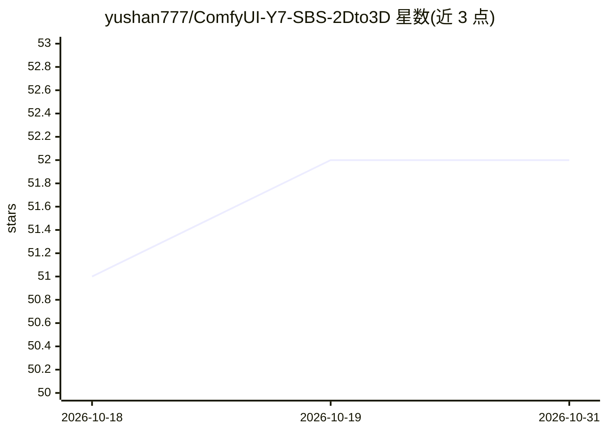

# yushan777/ComfyUI-Y7-SBS-2Dto3D

⭐ 52 · Python · MIT · 推送 2026-07-13 · [GitHub](https://github.com/yushan777/ComfyUI-Y7-SBS-2Dto3D) · 个人维护

**将 2D 图像/视频转为 SBS 立3D 格式的 ComfyUI 自定义节点**

提供两个 ComfyUI 自定义节点：输入图像或视频帧及对应深度图，通过 mesh_warping 或 grid_sampling 方法生成左右并列（SBS）立体图像/视频或红青 Anaglyph 格式，可在 Meta Quest、Apple Vision Pro 等 VR/AR 头显观看。支持平行/交叉眼模式、深度强度与模糊控制，视频节点含帧间时序平滑与批处理参数。深度图需由外部模型（推荐 Depth-Anything V2）生成，节点本身不产深度。经 ComfyUI Manager 或手动 git clone 安装。

## 筛选速览

| 维度 | 判定 | 备注 |
|---|---|---|
| AI 角色 | `ai-ecosystem` | LLM/agent 周边工具 |
| 许可风险 | `permissive` | MIT |
| 部署形态 | `None` |  |
| 模型依赖 | — | README 未给出锁定关系 |
| 硬件要求 | — | 无带数字的原话,不猜 |
| 安装摩擦 | `low` | 无编译、无系统依赖或容器化 |
| 成熟度 | — | 结构信号不足 |

## 能力要点

- 图像与视频两个节点，输入 base_image/frames 与深度图输出 SBS 或 Anaglyph
- mesh_warping 与 grid_sampling 两种 3D 渲染方法
- Parallel / Cross-eyed 两种观看模式，交叉眼模式可在普通 2D 屏幕裸眼观看
- 视频节点提供 temporal_smoothing 与 batch_size 参数

## 适用场景

- 把 2D 照片或视频转成 SBS 格式在 VR 头显上观看
- 用红青眼镜在普通显示器预览立体效果
- 在 ComfyUI 工作流中配合 Depth-Anything V2 深度估计节点做 2D 转 3D

## 场景标签

`图像视频处理` · 领域:感知与多模态

## 证据(README 行号)

> L3: Two ComfyUI custom nodes that convert 2D images or videos into a simulated 3D side-by-side (SBS) format, viewable on
> L39: ### Y7 SBS (Image)
> L65: ### Y7 SBS (Video)

## 星数曲线

2026-10-18 51 → 2026-10-31 52（+1）

---
*卡片 v1 · prompt 1.4 · 生成 2026-10-24 · 置信度 high · 依据 README sha `d33889d86827` · [字段定义](../../DATASET.md)*
