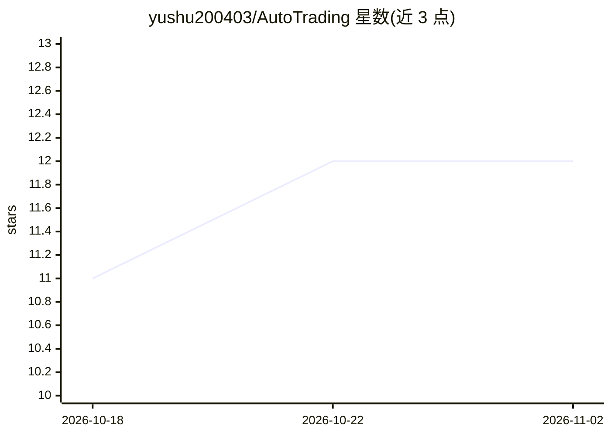

# yushu200403/AutoTrading

⭐ 12 · Python · Apache-2.0 · 推送 2026-09-07 · [GitHub](https://github.com/yushu200403/AutoTrading) · [官网](https://nof1.im33.xyz) · 个人维护 · 中文 README

**AI 驱动的币安 USDT-M 合约自动交易机器人（默认模拟盘）**

面向可行性验证的 AI 交易工作流：持续读取 Binance 永续合约真实公共行情，聚合技术指标、账户状态与 AI 记忆，通过严格 XML+JSON 工具协议调用 LLM（默认 DeepSeek，支持主备提供商故障转移）生成并执行交易决策。默认持久化模拟交易，实盘需显式确认配置；风控边界（杠杆、名义敞口、保护单）由环境变量控制。提供 Web 控制台、完整决策审计与自动对账机制，支持 Docker Compose 部署，多进程部署须改用 PostgreSQL。不构成投资建议。

## 筛选速览

| 维度 | 判定 | 备注 |
|---|---|---|
| AI 角色 | `ai-native` | 本体是模型或模型工具 |
| 许可风险 | `permissive` | Apache-2.0 |
| 部署形态 | `desktop` | 安装包/桌面程序 |
| 模型依赖 | locked-api |  |
| 硬件要求 | — | 无带数字的原话,不猜 |
| 安装摩擦 | `low` | 无编译、无系统依赖或容器化 |
| 成熟度 | `idea` | |

## 能力要点

- 默认模拟盘模式，与实盘共用行情、风控与订单编排
- LLM 通过严格工具协议生成交易决策，主备提供商故障转移
- PENDING/UNKNOWN/CRITICAL 决策的周期自动对账与保护单回补
- Web 控制台展示账户、交易与模型推理数据，CSRF+密码认证

## 适用场景

- 在模拟盘验证 AI 交易工作流的可行性
- 通过环境变量配置风控边界后接入币安实盘合约
- 审计每笔交易的模型原始输出与执行结果

## 场景标签

`金融量化` · 领域:学习与行业

## 证据(README 行号)

> L3: OpenNOF1 是一个面向可行性验证的 AI 交易工作流：系统持续读取 Binance USDT-M 永续合约的真实公共行情，聚合技术指标、账户状态和 AI 记忆，再通过严格的 XML + JSON 工具协议生成并执行交易决策。
> L14: - AI 协议：整批严格解析、主备提供商故障转移、响应完整性检查和执行前风控。

## 星数曲线

2026-10-18 11 → 2026-11-02 12（+1）

---
*卡片 v1 · prompt 1.4 · 生成 2026-10-31 · 置信度 mid · 依据 README sha `86767022c0b5` · [字段定义](../../DATASET.md)*
