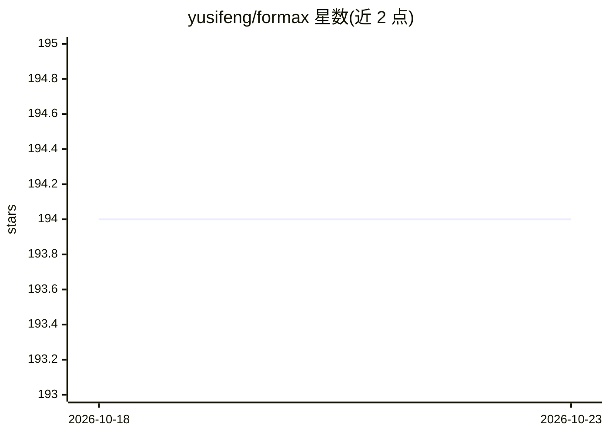

# yusifeng/formax

⭐ 194 · TypeScript · MIT · 推送 2026-07-24 · [GitHub](https://github.com/yusifeng/formax) · [官网](https://github.com/yusifeng/formax) · 个人维护 · 中文 README

**终端优先的软件工程 AI 助手，复刻 Claude Code 工作流**

Formax 是开源的 Claude Code 风格 AI 编程助手，提供终端 TUI 与 Web GUI 两种界面，支持 Plan 模式、/init 生成 CLAUDE.md、子代理与代码审查等会话功能。通过 npm 全局安装，首次运行引导配置凭据（默认目录 ~/.formax/），另有 JSON-RPC 后端与 WebSocket 桥接模式供 GUI/IDE 客户端使用。处于 Beta 阶段：hooks 支持不完整、MCP 不支持、WebFetch/WebSearch 存在稳定性差距、Gemini 仅在配置面出现而运行时未完全支持。

## 筛选速览

| 维度 | 判定 | 备注 |
|---|---|---|
| AI 角色 | `ai-native` | 本体是模型或模型工具 |
| 许可风险 | `permissive` | MIT |
| 部署形态 | `library` | 以包/库形式分发 |
| 模型依赖 | locked-api |  |
| 硬件要求 | — | 无带数字的原话,不猜 |
| 安装摩擦 | `low` | 无编译、无系统依赖或容器化 |
| 成熟度 | `idea` | |

## 能力要点

- TUI 与 Web GUI 双工作流（含 Electron 桌面客户端）
- Plan 模式、/init、子代理与代码审查功能
- app-server 提供 JSON-RPC 后端，serve 提供 WebSocket 桥接
- Anthropic 与 OpenAI 兼容路径可用

## 适用场景

- 在终端中用 AI 助手执行软件工程任务
- 学习与研究 Claude Code 风格 agent 的架构实现
- 通过 Web GUI 或 IDE 客户端进行多项目会话

## 场景标签

 · 领域:开发者工具/AI 编程助手

## 证据(README 行号)

> L5: Formax is an open-source implementation of a Claude Code-style AI assistant for software engineering tasks, with bot
> L101: Anthropic and OpenAI-compatible paths are available in setup/runtime flows. Gemini is present in config surfaces b

## 星数曲线

2026-10-18 194 → 2026-10-23 194（+0）

---
*卡片 v1 · prompt 1.4 · 生成 2026-10-22 · 置信度 high · 依据 README sha `e90aadda15a8` · [字段定义](../../DATASET.md)*
