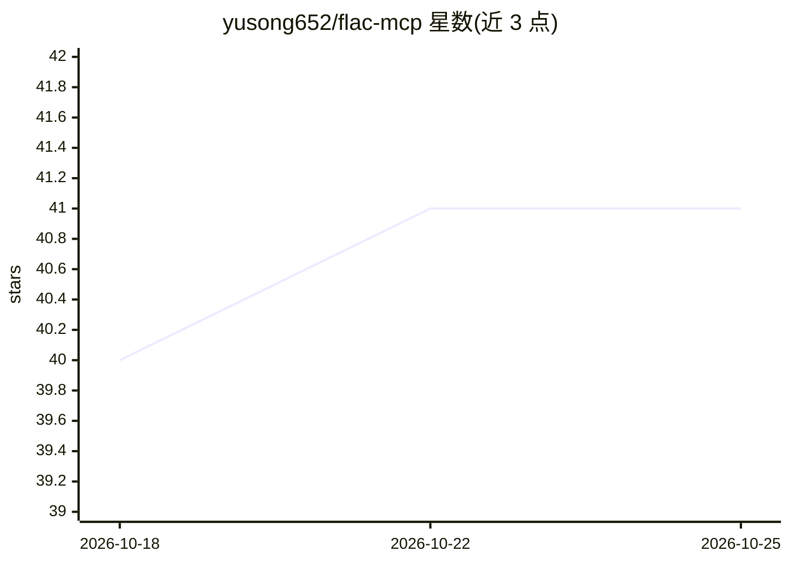

# yusong652/flac-mcp

⭐ 41 · Python · MIT · 推送 2026-06-27 · [GitHub](https://github.com/yusong652/flac-mcp) · [官网](https://pypi.org/project/flac-mcp/) · 个人维护 · 中文 README

**连接 AI 代理与 ITASCA FLAC 的 MCP 服务器（已弃用冻结）**

通过 Model Context Protocol 让 AI 代理操作 ITASCA FLAC 连续介质模拟软件：提供 10 个工具，其中 5 个文档工具可浏览/检索 FLAC 命令与 Python API 文档，5 个执行工具（需在 FLAC 内启动桥接脚本）支持交互式 REPL、长时任务提交、进度监控、中断与历史查询。支持 FLAC 6.0/7.0/9.0 文档，兼容 Claude Code、Codex CLI、Gemini CLI 等 MCP 客户端。注意：仓库已声明弃用并冻结，由多引擎的 itasca-mcp 取代，不再发布新版本。

## 筛选速览

| 维度 | 判定 | 备注 |
|---|---|---|
| AI 角色 | `ai-ecosystem` | LLM/agent 周边工具 |
| 许可风险 | `permissive` | MIT |
| 部署形态 | `library` | 以包/库形式分发 |
| 模型依赖 | — | README 未给出锁定关系 |
| 硬件要求 | — | 无带数字的原话,不猜 |
| 安装摩擦 | `low` | 无编译、无系统依赖或容器化 |
| 成熟度 | — | 结构信号不足 |

## 能力要点

- 10 个工具：5 个文档工具（免桥接）+ 5 个执行工具（需桥接）
- 分层浏览 FLAC 命令树文档，减少代理编造命令
- 任务生命周期管理：提交/监控/中断/历史
- 桥接脚本 start() 自检 PyPI 并自升级

## 适用场景

- 通过自然语言对话运行与调试 FLAC 模拟脚本
- 让 AI 代理查阅 FLAC 命令与 API 文档辅助建模
- 提交并监控长时间运行的模拟任务

## 场景标签

 · 领域:科学计算/岩土工程

## 证据(README 行号)

> L23: **flac-mcp** connects AI agents to ITASCA FLAC through the Model Context Protocol — browse documentation, run simul
> L31: **5 execution tools** — interactive REPL, task submission, progress monitoring, interruption, and history. Requires

## 星数曲线

2026-10-18 40 → 2026-10-25 41（+1）

---
*卡片 v1 · prompt 1.4 · 生成 2026-10-25 · 置信度 high · 依据 README sha `6154c52ba482` · [字段定义](../../DATASET.md)*
