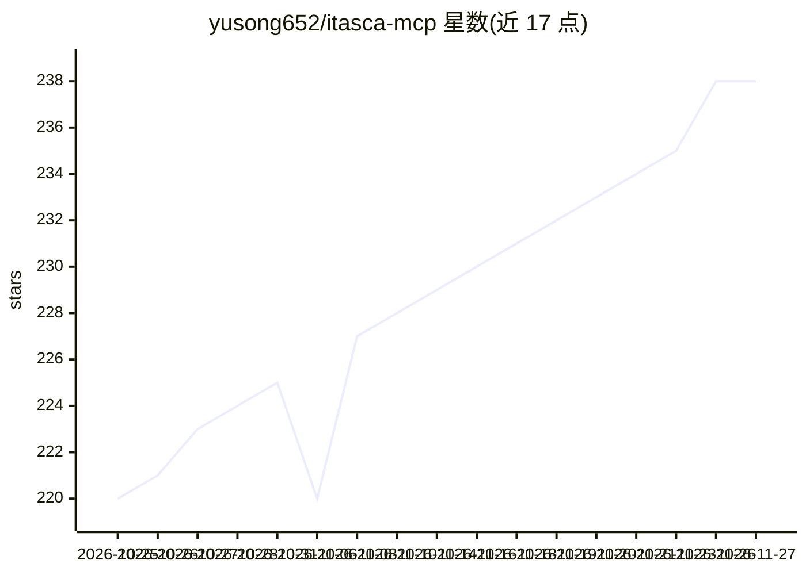

# yusong652/itasca-mcp

⭐ 238 · Python · MIT · 推送 2026-11-26 · [GitHub](https://github.com/yusong652/itasca-mcp) · [官网](https://pypi.org/project/itasca-mcp/) · 个人维护 · 中文 README

**通过 MCP 将 AI agent 接入 ITASCA 岩土仿真软件的工具**

itasca-mcp 是一个 MCP server，把 PFC、FLAC、3DEC、MPoint、MassFlow 等 ITASCA 岩土力学仿真引擎接入 AI agent：提供 2 个文档工具（按路径浏览与关键词检索命令/Python API/FISH 文档，无需 bridge）和 5 个执行工具（交互 REPL、任务提交、进度监控、中断、历史，需在引擎 Python 中安装并启动 bridge）。要求用户已安装 ITASCA 引擎（推荐 Subscription 9.0+，亦支持 PFC 6.0/7.0、FLAC 7.0、3DEC 7.0）与一个 MCP 客户端。支持多引擎多版本文档语料、任务生命周期管理与 GUI 人机协同。

## 筛选速览

| 维度 | 判定 | 备注 |
|---|---|---|
| AI 角色 | `ai-ecosystem` | LLM/agent 周边工具 |
| 许可风险 | `permissive` | MIT |
| 部署形态 | `desktop` | 安装包/桌面程序 |
| 模型依赖 | — | README 未给出锁定关系 |
| 硬件要求 | — | 无带数字的原话,不猜 |
| 安装摩擦 | `low` | 无编译、无系统依赖或容器化 |
| 成熟度 | — | 结构信号不足 |

## 能力要点

- 7 个 MCP 工具：2 个文档检索 + 5 个仿真执行
- 多引擎多版本文档语料（PFC 6.0/7.0/9.0，FLAC 7.0/9.0，3DEC 7.0/9.0）
- 运行中任务的 REPL 实时查看与任务生命周期管理
- 提供 bootstrap 指南供 agent 自主完成配置

## 适用场景

- 用自然语言让 agent 运行双轴压缩试验并绘制应力应变曲线
- 在 FLAC3D/3DEC 中建模边坡或隧道开挖并查询安全系数
- 仿真运行中不停机查看非平衡力等中间结果

## 场景标签

`科研工具` · 领域:学习与行业

## 证据(README 行号)

> L16: **itasca-mcp** connects AI agents to ITASCA's geomechanics simulation software — PFC, FLAC, 3DEC, MPoint, and MassF
> L22: ## Tools (7)
> L44: - **An AI agent** — Claude Code, Codex CLI, Gemini CLI, or any MCP-capable client

## 星数曲线

2026-10-25 220 → 2026-11-27 238（+18）

---
*卡片 v1 · prompt 1.4 · 生成 2026-11-25 · 置信度 mid · 依据 README sha `71e6c6ef0142` · [字段定义](../../DATASET.md)*
