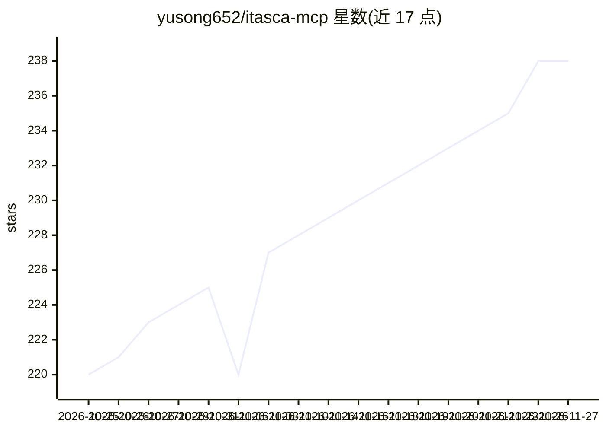

# yusong652/itasca-mcp

⭐ 238 · Python · MIT · 推送 2026-11-26 · [GitHub](https://github.com/yusong652/itasca-mcp) · [官网](https://pypi.org/project/itasca-mcp/) · 个人维护

**通过 MCP 让 AI 代理操作 ITASCA 岩土仿真软件的中间层**

MCP 服务器，将 AI 代理接入 ITASCA 岩土/地质力学仿真软件（PFC、FLAC、3DEC、MPoint、MassFlow），提供 7 个工具：2 个文档浏览/搜索工具（免桥接）与 5 个执行工具（交互式 REPL、任务提交、进度监控、中断、历史，需桥接）。面向岩土工程科研与工程用户，以自然语言对话完成建模、运行仿真、执行代码。需已安装 ITASCA 引擎（指定版本），并在引擎内置 Python 中安装并启动桥接程序。

## 筛选速览

| 维度 | 判定 | 备注 |
|---|---|---|
| AI 角色 | `ai-ecosystem` | LLM/agent 周边工具 |
| 许可风险 | `permissive` | MIT |
| 部署形态 | `desktop` | 安装包/桌面程序 |
| 模型依赖 | — | README 未给出锁定关系 |
| 硬件要求 | — | 无带数字的原话,不猜 |
| 安装摩擦 | `low` | 无编译、无系统依赖或容器化 |
| 成熟度 | — | 结构信号不足 |

## 能力要点

- 7 个 MCP 工具：文档浏览/搜索 + REPL、任务提交/监控/中断/历史
- 多引擎多版本文档语料（PFC 6.0/7.0/9.0，FLAC/3DEC 7.0/9.0 等）
- 仿真运行中可经 REPL 查看模型状态与中间结果
- 支持 agent 自行启动桥接（经引擎 console.exe）与自升级

## 适用场景

- 用自然语言运行双轴压缩试验并绘制应力应变曲线
- 在 FLAC3D/3DEC 中建模边坡、隧道开挖并求解安全系数
- 仿真长任务运行中查询不平衡力等中间结果
- 让代理检索引擎命令文档并绘制当前模型的接触力链

## 场景标签

`科研工具` · 领域:学习与行业

## 证据(README 行号)

> L16: **itasca-mcp** connects AI agents to ITASCA's geomechanics simulation software — PFC, FLAC, 3DEC, MPoint, and MassF
> L44: - **An AI agent** — Claude Code, Codex CLI, Gemini CLI, or any MCP-capable client

## 星数曲线

2026-10-25 220 → 2026-11-27 238（+18）

---
*卡片 v1 · prompt 1.4 · 生成 2026-11-27 · 置信度 high · 依据 README sha `c7af045497d9` · [字段定义](../../DATASET.md)*
