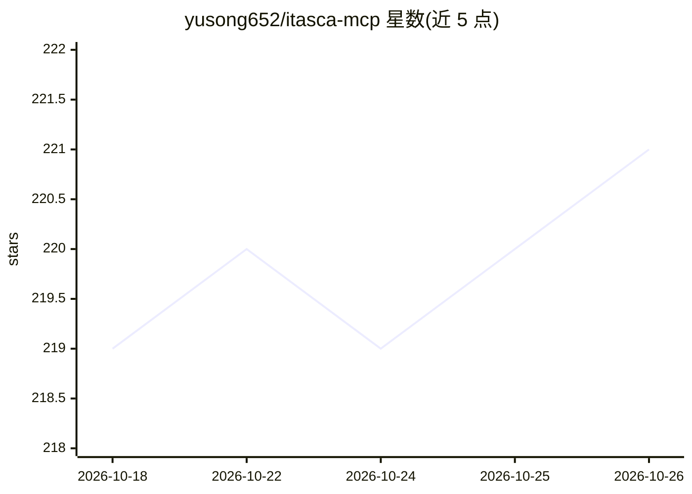

# yusong652/itasca-mcp

⭐ 221 · Python · MIT · 推送 2026-10-24 · [GitHub](https://github.com/yusong652/itasca-mcp) · [官网](https://pypi.org/project/itasca-mcp/) · 个人维护 · 中文 README

**让 AI agent 通过对话操作 ITASCA 岩土模拟软件的 MCP 服务器**

通过 Model Context Protocol 将 AI agent（Claude Code、Codex CLI、Gemini CLI 等 MCP 客户端）接入 ITASCA 系列岩土力学模拟引擎（PFC、FLAC、3DEC、MPoint、MassFlow）。提供 5 个文档工具（浏览/检索各引擎命令、Python API 与参考文档，无需 bridge）与 5 个执行工具（REPL、任务提交、进度监控、中断、历史，需在引擎内启动 bridge）。支持多引擎多版本文档语料、模拟运行中并行执行代码、感知 GUI 内的用户操作。要求已安装 ITASCA 引擎（推荐 9.0+，兼容 7.0 等）与 uv。

## 筛选速览

| 维度 | 判定 | 备注 |
|---|---|---|
| AI 角色 | `ai-ecosystem` | LLM/agent 周边工具 |
| 许可风险 | `permissive` | MIT |
| 部署形态 | `desktop` | 安装包/桌面程序 |
| 模型依赖 | — | README 未给出锁定关系 |
| 硬件要求 | — | 无带数字的原话,不猜 |
| 安装摩擦 | `low` | 无编译、无系统依赖或容器化 |
| 成熟度 | — | 结构信号不足 |

## 能力要点

- 10 个 MCP 工具：5 个文档浏览/检索 + 5 个执行与任务管理
- 多引擎多版本文档语料（PFC 6.0/7.0/9.0、FLAC 7.0/9.0、3DEC 7.0/9.0）
- 模拟运行中可并行执行 REPL 代码查看中间结果
- bridge 感知引擎 GUI 内用户的命令、绘图与数据文件操作

## 适用场景

- 用自然语言在 FLAC3D/3DEC 中建模并运行模拟
- 让 agent 查阅引擎文档后编写正确的模拟命令
- 长时间模拟运行中通过对话检查进度与中间结果

## 场景标签

 · 领域:岩土力学模拟/AI agent 工具

## 证据(README 行号)

> L16: **itasca-mcp** connects AI agents to ITASCA's geomechanics simulation software — PFC, FLAC, 3DEC, MPoint, and MassF
> L26: **5 execution tools** — interactive REPL, task submission, progress monitoring, interruption, and history. Requires

## 星数曲线

2026-10-18 219 → 2026-10-26 221（+2）

---
*卡片 v1 · prompt 1.4 · 生成 2026-10-22 · 置信度 high · 依据 README sha `d782be60a05f` · [字段定义](../../DATASET.md)*
