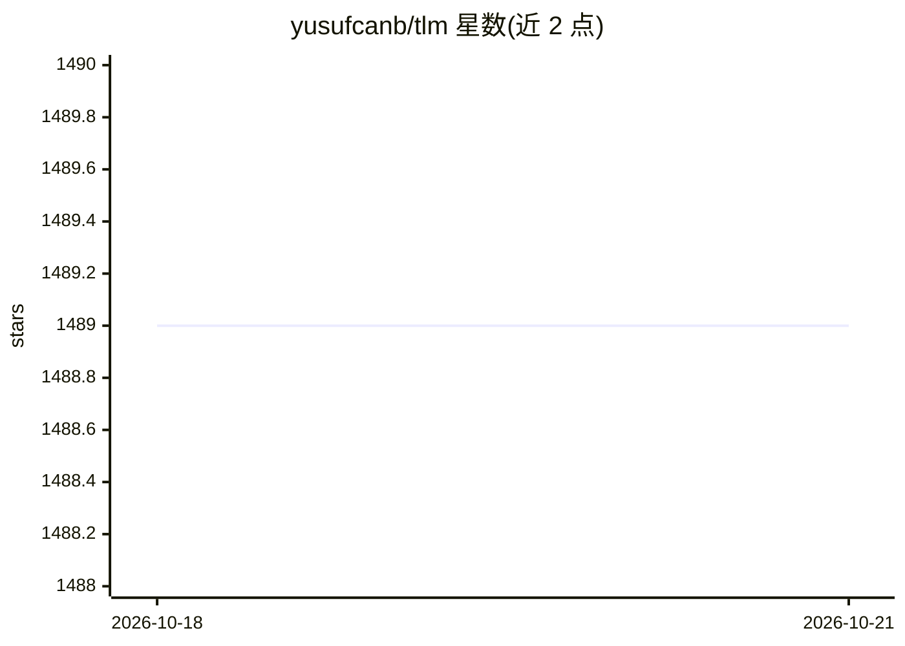

# yusufcanb/tlm

⭐ — · [GitHub]() · 个人维护

**本地终端 Copilot：基于 Ollama 生成、解释命令并问答**

运行于终端的 CLI 助手，通过本地 Ollama 调用 Llama 3、Phi4、DeepSeek-R1、Qwen 等开源模型，提供命令建议、命令解释与带上下文提问（One-liner RAG）。无需 API Key 与网络连接，自动检测 Powershell、Bash、Zsh，跨 macOS、Linux 与 Windows。以 Go 编写，提供安装脚本与 go install 两种安装方式，可配置模型与参数。

## 筛选速览

| 维度 | 判定 | 备注 |
|---|---|---|
| AI 角色 | `ai-native` | 本体是模型或模型工具 |
| 许可风险 | `permissive` | — |
| 部署形态 | `library` | 以包/库形式分发 |
| 模型依赖 | local-ok | 支持本地模型 |
| 硬件要求 | — | 无带数字的原话,不猜 |
| 安装摩擦 | `low` | 无编译、无系统依赖或容器化 |
| 成熟度 | — | 结构信号不足 |

## 能力要点

- 基于本地 Ollama，无需 API Key 与网络连接
- 命令建议（suggest）、命令解释（explain）、带上下文提问（ask，One-liner RAG）
- 自动检测 Powershell、Bash、Zsh
- 支持自选 Llama3、Phi4、DeepSeek-R1、Qwen 模型及参数

## 适用场景

- 在终端用自然语言获取命令建议并查看解释
- 离线环境下获得 CLI 辅助，不依赖云服务
- 结合本地代码上下文提问

## 场景标签

 · 领域:开发者工具/终端 CLI

## 证据(README 行号)

> L1: # tlm - Local CLI Copilot, powered by Ollama. 💻🦙
> L27: - 🚀 One liner generation and command explanation.

## 星数曲线

2026-10-18 1,489 → 2026-10-21 1,489（+0）

---
*卡片 v1 · prompt 1.4 · 生成 2026-10-21 · 置信度 high · 依据 README sha `3f4ef38a4e49` · [字段定义](../../DATASET.md)*
