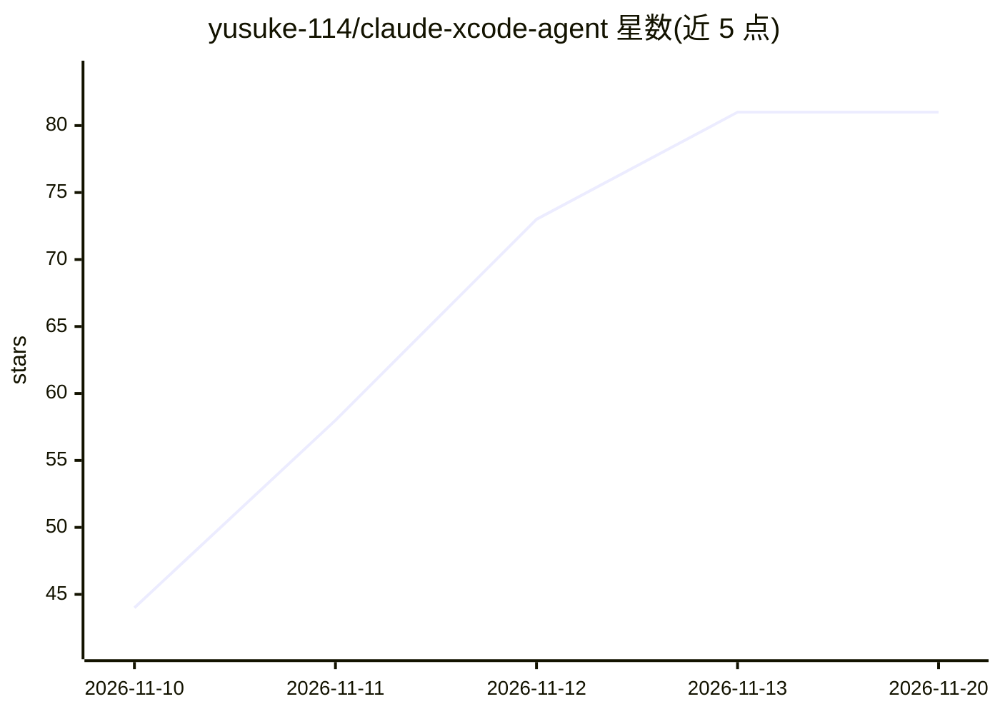

# yusuke-114/claude-xcode-agent

⭐ 81 · Shell · MIT · 推送 2026-11-09 · [GitHub](https://github.com/yusuke-114/claude-xcode-agent) · 个人维护

**让 Claude Code 作为 Xcode 27 内置编码 Agent 的桥接脚本**

面向 macOS 开发者的 shell 适配方案：Xcode 27 通过 ACP 协议与 agent 通信，本仓库的 claude-acp.sh 以两个角色分两次运行——先作为 agent 读取 config.json 注入 API key/网关 URL 并 exec ACP 适配器，再作为 claude 替换 setting-sources、追加 MCP 服务器并 exec 真正的 claude。解决 Xcode GUI 启动无 shell 环境变量、以及适配器硬编码导致全局设置被套用两个问题。setup.sh 一键安装 node、claude 与适配器；config.json 支持自定义 base_url、key、模型别名与 MCP 服务器。MIT 许可。

## 筛选速览

| 维度 | 判定 | 备注 |
|---|---|---|
| AI 角色 | `ai-ecosystem` | LLM/agent 周边工具 |
| 许可风险 | `permissive` | MIT |
| 部署形态 | `None` |  |
| 模型依赖 | locked-api |  |
| 硬件要求 | — | 无带数字的原话,不猜 |
| 安装摩擦 | `low` | 无编译、无系统依赖或容器化 |
| 成熟度 | — | 结构信号不足 |

## 能力要点

- claude-acp.sh 双角色 exec 桥接 Xcode ACP 与 Claude Code
- API key / 网关 / 模型 / MCP 服务器统一由 config.json 配置
- 默认不读取全局 ~/.claude/settings.json，可选 opt-in
- setup.sh 自动安装 node、claude 与适配器并输出 Xcode 配置路径

## 适用场景

- 在 Xcode 27 中用自己的 API key 或网关运行 Claude Code 作为编码 Agent
- 为 Xcode 场景单独配置 MCP 服务器与环境变量而不影响全局设置
- 通过网关（base_url + token）接入自管端点使用 Claude

## 场景标签

`编码 Agent` · 领域:编码与开发

## 证据(README 行号)

> L3: Claude Code as an Xcode 27 agent, using your own API key or gateway.
> L7: Xcode talks to agents over ACP, and an adapter (`claude-agent-acp`) bridges ACP to Claude Code. Used on its own, the
> L21: 1. **As agent**: loads `config.json` into env, points `CLAUDE_CODE_EXECUTABLE` at itself, execs the adapter.

## 星数曲线

2026-11-10 44 → 2026-11-20 81（+37）

---
*卡片 v1 · prompt 1.4 · 生成 2026-11-18 · 置信度 high · 依据 README sha `7298537243b0` · [字段定义](../../DATASET.md)*
